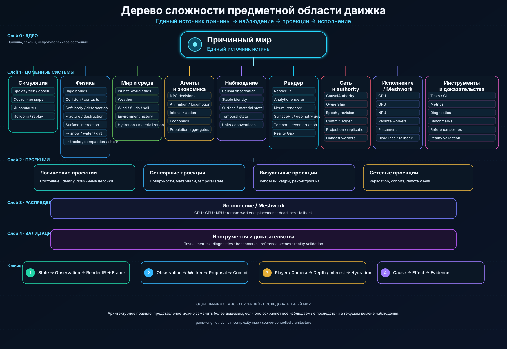

# Game Engine Core

> Development model: **one active branch — `main`**. Gameplay is frozen until rendering, networking, audio and physics gates are complete. See [docs/ENGINE_FIRST.md](docs/ENGINE_FIRST.md).

A single TypeScript package for deterministic scenes, WebGPU rendering, rigid and structural physics, procedural vehicles, synthesized audio, and character movement. It has no JavaScript runtime dependencies.

[](docs/DOMAIN_COMPLEXITY.md)

The architecture is organized around one causal source of truth. See [the domain complexity map](docs/DOMAIN_COMPLEXITY.md), the [causal render contract](docs/CAUSAL_RENDER_CONTRACT.md), and [server authority](docs/SERVER_AUTHORITY.md).

## Build and check

```sh
bun install --frozen-lockfile
bun run build
bun run check
```

The package exports simulation and scene APIs from `src/index.ts`, and `BrowserRuntime` plus `WebGPURenderer` from `src/browser.ts`. Browser rendering requires WebGPU. `BrowserRuntime.create(canvas, scene, {audio: true})` creates the renderer and fixed-step simulation; call `resume()`, `pause()`, `step()`, or `dispose()` as needed. Audio starts after `activateAudio()` from a user gesture.

A scene is validated data (`SceneSpec`). `Scene` can run without a browser for deterministic simulation. `PhysicsWorld` handles rigid contacts. Vehicle geometry comes from `compileVehicle` and the passenger, pickup, and M3 definitions. `AnimationSystem` owns walker and wheel transforms. `WalkWorld` supplies bounded static obstacle and camera queries; `BrowserRuntime.controlWalker(id, {world})` connects keyboard, pointer and touch input to an authored walker.

Source code lives in `src/`; focused tests live in `test/`. Build output in `dist/` is generated and ignored.


## Infinite world streaming

The engine has a transport- and game-independent infinite-world boundary.
VisibilityInterest turns one camera/observer into a bounded, non-overlapping
quadtree of tile demands. Close terrain uses 128 m base tiles; distant terrain
automatically becomes coarser. Altitude increases the apparent horizon, so an
aircraft can see tens or hundreds of kilometres without asking the generator for
millions of near-detail chunks.

InfiniteWorld owns bounded asynchronous generation, residency, cancellation,
installation and eviction. The application owns tile meaning.

Render visibility is deliberately independent from physics and gameplay simulation
interest. Seeing a mountain 100 km away does not activate its collision bodies,
NPCs, economy or other detailed simulation.

See docs/INFINITE_WORLD.md.

## Rust World compiler (ahead of time)

The experimental `worldc` compiler converts `.world` declarative scenes into a
fixed-layout `.wscn` binary with SI units and stable entity IDs. It compiles
**before** execution; scene loading hydrates the existing `SceneSpec` and
preserves the engine's physics/render hot path. The v0.1 language currently
covers entities, primitive physical geometry, camera, material, initial motion,
and basic environment. It does not replace the existing TypeScript DSL.

```sh
cargo test --manifest-path compiler/Cargo.toml
cargo run --manifest-path compiler/Cargo.toml -- compile examples/worlds/collision.world
```

Read [compiler/README.md](compiler/README.md) for the language, binary ABI,
and `sceneFromURL` integration. `decodeWorldBinary()` is exported by both the
core and browser packages.
