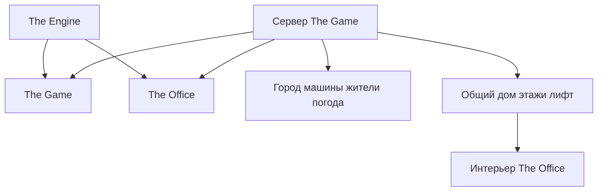

# Game и Office на общем Engine: итоговая проверка — 2026-10-17

Общий движок исходной игры заменён на The Engine; существующий The Office входит в тот же сохранённый мир. Единственный игровой вход Game остаётся src/game/client.ts, authority — src/server/index.ts. По умолчанию используются Engine WebGPU renderer, compound integration/contact solving на 120 Гц, character motor, EngineKernel, планировщики/пул workers, FixedClock, SpatialHash, материальные/contact/структурные расчёты, CausalWorldRuntime и BlueprintRegistry. Сохранены исходные правила и процедурные источники Game, протокол, авторские звуковые модели и host-адаптеры браузера/Bun SQLite. Оставшиеся названия src/engine не означают второй исполняемый движок: границы разобраны в src/engine/README.md и core-boundary-audit.json. Нормализованный structural graph побайтно сохранён в Engine и остаётся отдельной моделью от SI/XPBD StructuralBody.

Команды и фактический результат: bun run game:check — exit 0, 1530 pass / 7 PostgreSQL skip / 0 fail, 6 208 032 assertions, 239 файлов, 931.95 s (session 14961). Bun run check — exit 0, 684 pass / 19 skip / 0 fail, 703 tests, 71.142 s (92054). Bun run game:office:check — exit 0, 155 pass / 7543 assertions / 0 fail, 10.18 s (67264). Типы и сборки Game/Office проходят; Vite index-BWVxRD0M.js, прежнее предупреждение размера bundle. После полной Game-серии изменены только учебный текст/ссылка владельца ядра (17 docs-тестов / 108 assertions и повторные types/build) и браузерная QA-проверка first-person видимости (повторная typecheck и успешный нативный проход). Повтор полной серии только ради этих проверочных текстов не выполнялся.

Новые проверки: сравнение с замороженными независимыми исходными FixedClock/SpatialHash на 1600 шагах/запросах; material/contact/structural graph — прежние числа, причинность импульса, пластичность/разрушение, sleep и skin bindings; 1200 событий календаря и 96 ревизий definitions сохраняют порядок, бюджеты и canonical IDs/cache identity. Исправлен существовавший в Engine RangeError для caller-owned SpatialHash-результата 140 000 объектов: iterative fill вместо push(...source). Engine не импортирует Game или Office. Схема сохранения и Game dispatch/commit policy не менялись.

Нативный GPU CAPTURE_EXISTING=1 CAPTURE_PORT=3007 CAPTURE_DEBUG_PORT=3330 CAPTURE_GPU=1 bun tools/capture.ts --office, label core-services-engine-native-20261017-r2, walking/transport/residents — exit 0 (55849): четыре оригинальных Game-ракурса Office и 21 состояние настоящего Office UI. Между входами то же тело; ходьба с ACK 1.813 м, семь надёжных car-команд с server receipts/state, водитель/пассажир. Сохранённый resident:building:-4:1:1:27462 найден, наблюдается и перехвачен в своём живом месте; движение, остановка и возврат проходят. Office physics bodies/steps=0, GPU errors=[], cleanup players=0/observer=true/view=office. R1 ошибочно требовал subjectVisible при исходной first-person камере: raw report подтверждает subjectPresent и подавление 50 собственных meshes. Исправлен только QA-критерий, а камера/production-renderer не менялись. Failure report и PNG сохранены; stdout R1 утрачен из-за повторного пути log в копии launcher, текущий native-r1.log содержит R2 и скопирован в native-r2.log. Autoplay/powerPreference, dev notices и debug/events/favicon 404 записаны; voice-device-unavailable toast не является проверкой микрофона.

Отдельный нативный bun tools/capture.ts --game-workforce, label core-services-workforce-native-20261017-r1 — exit 0 (6712), четыре состояния. Свежий QA-аккаунт через обычную игру/панели регистрирует компанию, финансирует её, арендует настоящий этаж с рабочим столом, покупает конечные еду/воду, нанимает существующего Дениса Миронова resident:17499:0 и создаёт временный harness-ключ. Непустые company/lease/key остаются у аккаунта при реальном захвате тела работника и возврате; кошелёк NPC не подменяется. Discovery объявляет workers.list / worker.inspect / worker.act / worker.release; нативный цикл выполняет list/inspect/act, а release отдельно покрыт полной тестовой серией; повтор UUID идемпотентен, человек имеет приоритет, старая ревизия после возврата отклоняется. При players=0 внешний цикл решений ведёт NPC через обычные улицы/светофор/лифт к столу Y=6.655, отдых, еду/воду и работу. 223 отсчётов; 900 work ticks, 8 ₽ зарплаты, один завершённый заказ, 12 ₽ выручки. Нужды/позиция/баланс не редактировались напрямую. После reconnect видна та же компания. Cleanup обычными командами отзывает ключ, увольняет только QA-сотрудника, освобождает QA-аренду и возвращает остаток средств; игроков 0. Сохраняется история новой QA-компании/сотрудника/заказа.

Game PID 25404 → 6564; live health подтверждает фактический EngineKernel, четыре planner/pool-провайдера и семь core-services. До обновления сделан согласованный SQLite snapshot. Финально 5553 → 5678 записей, 0 missing old rows, 0 changed protected rows (329 защищённых исходных записей), каждый прежний company/lease/employee/order побайтно сохранён, integrity ok. Seed/revision 29/13, editor/geometry 62/9. Vite 21580 и voice 15312 те же. Backend 7860 в manual mode: 8 сохранённых включённых конфигураций, 0 активных Code jobs; hub 8765 не запускался. Ожидающий отдельного ответа запуск голосового hub не входит в завершённую игровую интеграцию.

Свежий CAPTURE_GPU=1 PERF_FIXED_SETTINGS=1 PERF_WARMUP_FRAMES=180 PERF_LIVE_FRAMES=900 PERF_PROFILE=0 bun tools/capture.ts --live: 60.29 FPS, p50 18.50 ms, p95 28.80 ms на Radeon 760M, окно 1280×720 / внутренний рендер 704×396, TAA и дальность 420 м, adaptive=false. Это короткий неподвижный замер живого Game после остальных проверок. Фактические время/погода записаны; это не парное сравнение, движение, Office UI или подтверждение стабильных 60 FPS. Постановочные screenshot FPS не используются как benchmark. Перелёт в воздухе не переснимался: свежая полная регрессия и прежний отдельный нативный Office aircraft controls/taxi gate покрывают этот неизменённый участок в своих пределах.

Итоговые данные и SHA-256 архив: docs/render-evidence/core-services-engine-20261017.json; FPS: docs/render-evidence/fps-live-20261017-core-services-r1.json. В манифесте перечислены все требования, границы и отдельные прежние доказательства. Обычный запуск из Engine: bun run game:office; Game http://127.0.0.1:3007/, существующий Office http://127.0.0.1:5173/. Подключение пользовательского harness описано в Game docs/HARNESS.md.

---

# Планирование жителей и фоновые workers исполняет Engine — 2026-10-17

В Engine перенесены SimulationInterestPlanner, LocationWorkScheduler и LocationWorkerPool. Game оставляет радиусы 70/240/900 м, задержку понижения 180 тактов, свои периоды районов 60/60/300/1800 и прежние codec/worker-программу. Старые точки импорта стали конфигурационными адаптерами к Engine. Рабочая часть GameWorldRuntime после metadata-getter, включая отмену, проверку исходных записей и commitLocation, побайтно сохранена. Новый сервер PID 25404 подтверждает engine.planning.residents/locations/workScheduler/workerPool=true; шесть стадий authority по-прежнему исполняет EngineKernel.

Полные команды: bun run game:check — exit 0, 1524 pass / 7 PostgreSQL skip / 0 fail, 6 148 239 assertions, 237 файлов, 765.56 s. Bun run check — exit 0, 678 pass / 19 skip / 0 fail, 697 tests, 67.28 s. Bun run game:office:check — 155 pass / 7543 assertions / 0 fail, 10.66 s. Типы/сборки Game и Office проходят. Два независимых сравнения с зафиксированными прежними планировщиками покрывают смену наблюдателей, критические тела, удаление/возврат жителей, бюджеты, старую отложенную работу и большие такты. Шесть новых Engine-тестов проверяют также реальные Node-workers с другим codec, передачу буферов, каждое поле токена, отмену, старые callbacks, crash/timeout и drain. 21 проверка Game workers/world-runtime прошла с настоящими Bun-workers и SQLite: выплаты/еда, отмена при пробуждении и отклонение устаревшего владельца сохраняются.

Согласованный снимок создан перед Game PID 18304 → 25404. Финальная проверка после браузера/FPS: 0 пропавших старых строк, 0 изменений 328 защищённых записей, integrity ok; прежние 24 компании, 19 сотрудников и 17 заказов совпадают. Мир 29/13, редактор/геометрия 62/9. Vite 21580 и voice 15312 прежние, automatic_resume=false, восемь задач неактивны, hub 8765 не запускался.

Нативный CAPTURE_GPU=1 bun tools/capture.ts --office с walking/residents: exit 0, четыре ракурса Office в исходном Game и 12 состояний настоящего Office UI. Между входами сохранён player:23d48f02-5402-49a5-8df3-2b904145ecc7, движение с ACK 1.981 м. Существующий resident:building:-4:1:1:27462 найден в сохранении и принят под управление в своём текущем месте: 0.181 м между живыми отсчётами takeover, затем 0.505 м движения, остановка и возврат исходного тела. Office physics 0 тел/шагов, GPU errors=[], cleanup players=0/observer=true; три кадра просмотрены. Владение непустым бизнесом проверяется полной Game-серией: свежий браузерный аккаунт компаний/аренды не имеет. Пул в живом проходе создан с одним worker, submitted=0; исполнение самих фоновых заданий доказано отдельно настоящими Bun/Node-workers. Диагностика браузера сохраняет прежние autoplay/powerPreference предупреждения, debug/events/favicon 404 и поздний controller-world 403 при выходе; observer вернулся подключённым, устаревшие ответы ограничены generation/scope.

Game/controller/DSP остались ba0ec1cc/d1854c3e/8b6ec786, UI index-PtG9U8WP.js также прежний. Отдельный неподвижный замер: 50.09 FPS, p50 19.1 ms / p95 30.1 ms, Radeon 760M, 1280×720 / внутренние 704×396, 900 кадров после 180 прогрева. Живое освещение — 17:49, facadeNight=0.767; это отличается от прежних сцен и не является парной оценкой изменения планировщиков или гарантией 60 FPS.

Цель активна. Аудит подтвердил следующие оставшиеся активные дубликаты: src/server/fixed-clock.ts повторяет существующие часы Engine, src/engine/world/spatial-index.ts всё ещё обслуживает Game runtime/math.js, а material-mechanics/contact-excitation/structure содержат общие расчёты физики и удара. Их нужно перевести на Engine с сохранением порядка контактов и численных результатов. Границы production-calendar, canonical blueprint identities и host persistence требуют отдельного решения; неиспользуемые совместимые helpers не считаются активным ядром только по имени папки.

[Архив, исходники, логи и аудит границ](render-evidence/world-planning-engine-20261017.json). [Вечерний FPS](render-evidence/fps-live-20261017-world-planning-r1.json).

# Серверные стадии Game исполняет EngineKernel — 2026-10-17

Производственный createAuthorityKernel теперь создаёт GameAuthorityKernel, который передаёт планирование и исполнение шести прежних стадий EngineKernel. Исходные authorityStages, игровые обработчики и их живой контекст сохранены; адаптер использует существующий context:none. Действующий сервер PID 18304 подтверждает engine.kernel.backend=the-engine, engineKernel=true, modules=6 и compiledPrograms=1 через /api/health. Прежний WorldKernel больше не исполняет производственную authority. Его независимая замороженная копия остаётся тестовым эталоном.

В Engine добавлен явный resourceOrder:id для прежнего синхронного владельца состояния; строгий explicit остаётся значением по умолчанию. Явные зависимости сохраняют приоритет. Большие НОК периодов больше не создают неограниченную таблицу: до 4096 тактов — готовые планы, далее максимум 256 кэшированных шаблонов. Переносимые контексты Engine по-прежнему неизменяемы. Сравнение с исходным ядром проверяет все четыре уровня, шесть частот публикации, эффекты и порядок стадий, вложенные вызовы, ошибки, позднюю регистрацию, редкие частоты и такты до MAX_SAFE_INTEGER.

Команды и фактические результаты: bun run game:check — exit 0, 1522 pass / 7 skip / 0 fail, 6 115 494 assertions, 236 файлов, 787.21 s. Bun run check Engine — exit 0, 672 pass / 19 skip / 0 fail, 691 tests, 66.76 s. Bun run game:office:check — 155 pass / 7543 assertions / 0 fail. Типы и сборки Game/Office UI проходят. Пропуски PostgreSQL и отдельных Rust/WSCN/WASM сценариев перечислены в полных логах. Начальная попытка pipeline отклонила неявный ресурсный конфликт; исправление выбирает явную политику Engine, сохраняя строгий режим по умолчанию. Первый вызов сборок в новой оболочке не нашёл Bun и ничего не запустил; успешные команды затем выполнялись с явным PATH.

Перед заменой Game PID 4296 создан согласованный SQLite-снимок. После перезапуска, браузерной проверки и FPS: missingRows=0, changedProtectedRows=0 для 327 прежних защищённых записей, integrity=ok; прежние 24 компании, 19 сотрудников и 17 заказов совпадают. Seed/revision 29/13, редактор/геометрия 62/9. Vite PID 21580 и голосовой клиент PID 15312 сохранены. Восемь автозадач неактивны, ручное возобновление включено, hub 8765 не запущен.

Нативный браузерный R1 exit 0: четыре ракурса установленного Office в Game, затем настоящий Office UI и 21 состояние управления. При переходе Game → Office сохранён тот же player:4c42c79d-f36d-42cc-ad18-a1baf883a197; доверенная клавиатура переместила его на 1.256 м с ACK. Семь команд ABS/ESP/передач применены на серверном такте, проверены водитель/пассажир и выход. Существующий resident:building:-4:1:1:27462 найден в сохранении, наблюдался и принят под управление в текущем месте: 0.120 м между живым эталоном и takeover, затем 0.308 м движения с ACK, остановка и возврат прежнего тела. Аккаунт совпадает; у свежего браузерного аккаунта нет компаний/аренды, поэтому непустое владение этим прогоном отдельно не доказано — оно проверяется полной Game-серией и прежним рабочим бизнес-сценарием. Office physics=0 тел/шагов, GPU errors=[], cleanup players=0/observer=true. Пять кадров просмотрены.

Пересобраны game.js ba0ec1cc / 2 511 057 bytes, office-controller.js d1854c3e / 1 562 954 bytes; DSP 8b6ec786 не менялся. UI index-PtG9U8WP.js. Новый независимый стационарный замер Radeon 760M: 55.63 FPS, p50 10.1 ms, p95 29.0 ms; окно 1280×720, внутренний рендер 704×396, 900 кадров после 180 прогрева. Это не парное измерение изменения ядра и не проверка стабильных 60 FPS, движения, транспорта или FPS Office. Прежние 65.94 FPS относятся к старой сборке.

Полная цель остаётся активной. В GameWorldRuntime ещё используются общие InterestPlanner, LocationScheduler и LocationSimulationPool из прежнего src/engine. Нужно закончить их перенос/границы и аудит сетевого, звукового и игрового кода; одна замена стадий не доказывает полную замену движка.

[Логи, исходники, снимки и проверка архива](render-evidence/authority-engine-kernel-20261017.json). [Новый FPS](render-evidence/fps-live-20261017-authority-engine-r1.json).

# Аудит Engine: полная проверка и оставшееся ядро Game — 2026-10-17

Полный `bun run check` Engine: exit 0, 670 pass, 0 fail, 19 skip, 689 tests, 65.94 s. Типы/сборка также прошли. Пропуски сохранены по именам в skipped-tests.log; это отдельные Rust/WSCN/WASM сценарии, а не результат нативного Game или Office. Начальный прогон 669 pass / 1 fail / 19 skip выявил устаревшее ожидание теста ground-litter: frame.slice(176) захватывал также добавленный cameraDepth vec4. writeSurfaceWeather владеет только 168..179, а webgpu.ts пишет cameraDepth начиная с 180. Исправлен только тест: проверка четырёх полей 176..179 и сохранности соседних значений при записи/сбросе погоды. Реализация рендера не менялась. Отдельный прогон 4 pass / 0 fail подтверждает текущий файл; после полного прогона уточнён только комментарий с назначением соседних полей.

Аудит исполнения обнаружил реальный остаток цели: src/game/authority-pipeline.ts всё ещё создаёт WorldKernel из прежнего Game src/engine/world/scheduler.ts. В Engine есть EngineKernel с теми же пятью фазами input/plan/simulate/commit/publish и четырьмя совместимыми уровнями detailed/active/aggregate/dormant. Заменить импорт без проверки поведения недостаточно: нужны сохранение порядка стадий, их ресурсных конфликтов, частот публикации и расширений текущей authority. Следующий шаг — перевести исполнение Game на EngineKernel с регрессией относительно сохранённого WorldKernel, полными Game-проверками и проверкой работающего сервера. Два исходника и существующие тесты стадий сохранены до изменений. Ядро Game в этом аудите не менялось и сервер не перезапускался.

Game PID 4296, Vite 21580, voice 15312 прежние; players=0, восемь автозадач Codex неактивны. Полная цель не достигнута: сначала нужно устранить эту границу исполнения и закончить аудит прочих общих подсистем/исходных функций. Нативные проверки самолёта и приборов из предыдущей фазы остаются действительными, это не новый FPS или GPU-прогон.

[Исходники, полные логи и оставшиеся требования](render-evidence/runtime-ownership-audit-20261017.json).

# Office: приборы самолёта и исходные органы управления — 2026-10-17

В Office добавлены исходные серверные приборы самолёта: воздушная скорость (км/ч), высота над землёй, вертикальная скорость, процент тяги и предупреждение срыва с прежним порогом Game. Приборы появляются только для текущего самолёта; отсутствующие/устаревшие/нечисловые данные не показываются. Тип FlightInstruments вынесен в чистую модель и используется обоими входами. Первая проверка UI обнаружила, что импорт типа через реализацию автомобильных приборов затягивал несовместимые с UI .ts-импорты; модель отделена, настройки компилятора не ослаблялись.

`bun run game:office:check`: 155 pass, 0 fail, 7543 assertions / 15 файлов / 10.92 s; после переноса только type import отдельный adapter typecheck также exit 0. Исходные `bun test --timeout 60000 ./test/flight.test.ts ./test/aircraft-instances.test.ts`: 23 pass, 0 fail, 133 expect calls, 3.63 s. Включены настоящий SolidWorld-взлёт, отсутствие взлёта без крыльев, W/Down-разбег, петля/бочка, посадочные места/устаревшая тяга и исходные движущиеся меши. Game/Office UI types и сборки exit 0; Game/controller/DSP остались побайтно 4ef45cf1/539fcddd/8b6ec786, UI index-CyFzF7F_.js.

Нативный R2: exit 0, 12 состояний. Тот же player:c7fa2939-6b49-4e31-8083-f12718d49daf дошёл от исходной точки до настоящего vehicle:1020 (kukuruznik), сел пилотом, увидел приборы и управлял рулями/тягой/колёсным тормозом. Серверные pitch/roll достигли 0.832, проверен руль направления. Реальное руление по полосе 1.288 м, остановка до 0.0255 м/с; диалог сбросил тягу и не возобновил её при закрытии. Пассажир не передал flight и не сдвинул самолёт (0 м), приборы доступны как в исходном Game. После выхода приборы исчезли. Пять кадров просмотрены; GPU errors=[], Office physics 0 шагов/тел. Cleanup players=0, walking=false. Браузерный маршрут в воздухе здесь не выполнялся: это тот же объём native acceptance, что исходный qa-flight-browser.ts; взлёт и воздушная динамика проверены отдельно исходной серией, а 900 последовательных воздушных входов — адаптером.

R1 exit 1 сохранён: скрипт продолжал идти во время поворота у точки входа и кружил в 0.8 м от неё. R2 проходит последние метры короткими шагами с остановкой. В R1 также зафиксирована слишком ранняя выборка cleanup walking=true при уже players=0; R2 ждёт возврата представления Office. Это исправления QA, игровые позы/коллизии не менялись. Оба снимка SQLite: missing=0, changedProtected=0 (327), прежние 24 компании / 19 сотрудников / 17 заказов неизменны, integrity ok. Редактор/геометрия 62/9; PID Game/Vite/voice 4296/21580/15312 сохранены, восемь автозадач Codex неактивны, hub 8765 не запускался.

Общая цель активна. Следующий шаг — итоговая проверка границ подсистем и сохранения исходных функций; сам этот прогон не доказывает завершение полной замены движка.

[Команды, исходники и доказательства](render-evidence/office-flight-parity-20261017.json).

# Office: граница аватаров редактора и игровых NPC — 2026-10-17

Исправлены HTML-подписи редакторских аватаров: projections использует тот же authoringVisibility.hidden, что их 3D-модели. Скрытый выбранный предмет также не публикует редакторскую проекцию. Диагностика различает аватар, попавший в кадр, и фактически показанную подпись.

Нативный R1: exit 0, 11 состояний. Для проверки UI добавлен один явно обозначенный браузерный аватар [QA], без запуска задачи Codex. Его 15 отправок позы перехвачены только в тестовом браузере, ни одна не дошла до backend; POST задач/автозадач не вызывался. В обзоре 1 подпись/1 HTML bubble; при управлении существующим NPC resident:36117:0 внутри настоящего офисного здания аватар попадал в камеру (projectedAgents=1), но его подпись и bubble оставались 0; после возврата в обзор снова 1/1. Это проверяет скрытие, а не случайное отсутствие аватара за камерой. Тестовый аватар не выдаётся за канонического NPC.

В том же прогоне настоящий NPC наблюдался, был принят под управление на месте (разница 0.000330 м), прошёл 0.454 м с authority ACK, остановился и вернул управление прежнему телу аккаунта. Компания/аренда аккаунта сохранились. Проверены три кадра, GPU errors=[], Office physics 0 шагов/тел. После очистки players=0, walking=false, тестовый аватар удалён и fetch восстановлен. Сохранённые 8 конфигураций и 8 старых поз Office побайтно по JSON совпадают; активных автозадач 0, тестовой позы в backend нет. Game SQLite missing=0, changedProtected=0 (326), компании/сотрудники/заказы неизменны, integrity ok; редактор/геометрия 62/9, PID Game/Vite/voice 4296/21580/15312 сохранены.

Типы Game и Office UI, сборка UI exit 0, index-BsYBQN_y.js. Исходники адаптера и проверенные 155 тестов / 7538 assertions не менялись; заново эта серия не запускалась. Game/controller/DSP остаются 4ef45cf1/539fcddd/8b6ec786; нового FPS замера нет. Общая цель активна: остаётся завершение аудита исходных функций, включая нативное управление самолётом через Office и границы общих подсистем Engine.

[Исходники, команды и доказательства](render-evidence/office-authoring-boundary-20261017.json).

# Office: команды автомобиля и серверное состояние кнопок — 2026-10-17

Нативный Office R2 завершился с кодом 0: 13 состояний, тот же настоящий персонаж player:3bbd17da-5b22-4cec-a425-82cdf8bd3243 и исходный универсал vehicle:1001. Семь надёжных команд abs/abs/esp/esp/up/down/auto получили applied, ok=true и тик выполнения. ABS проверен и по конфигурации, и по биту приборов; ESP и ручной режим — по реплицируемой конфигурации; передачи и подсветка кнопок сверены с authority. Машина проехала 1.316 м; пассажир при W не сдвинул её (0 м) и не видел кнопок водителя. Удержание E выключает/включает двигатель, Space передаётся как ручник, короткий E выходит. Проверены пять кадров. Ошибок renderer нет, физика Office 0 шагов/тел, очистка вернула view=office и players=0.

Кнопки доступны только водителю с совпадающим powered-инструментом; пилот, пассажир, велосипед и устаревшие приборы отфильтрованы. Пилоту показана подсказка исходного полёта. Статус ABS/ESP/автомата приходит из серверных полей extra, без оптимистического переключения. Нативный полёт здесь не проверялся. Типы Game/адаптера/Office UI и сборка UI проходят; `bun run game:office:check` — 155 pass, 0 fail, 7538 assertions, 15 файлов, 11.24 s. Первый typecheck выявил обращение к отсутствующим instruments; исправлен optional access. Первый нативный R1 упёрся в соседний сохранённый hatch: маршрут обходил только выбранный wagon. R2 выбирает дверь по маршруту, свободному от всей ближайшей сохранённой автоколонны; коллизии/позиции не обходятся и не редактируются.

Снимки R1/R2 сохранили все старые строки, 326 защищённых записей, 24 компании / 19 сотрудников / 17 заказов; integrity ok. PID Game 4296, Vite 21580 и голосового клиента 15312 сохранены, редактор/геометрия 62/9. Восемь автозадач Codex неактивны, hub 8765 не запускался. Game/controller/DSP побайтно 4ef45cf1/539fcddd/8b6ec786, UI index-BZuHRffM.js. Это не новый замер FPS.

Общая цель активна. Аудит нашёл конкретный остаток: скрытые при игре 3D-аватары задач редактора продолжают публиковать HTML-подписи, поскольку projections не использует тот же признак walking. Следующий шаг — исправить и проверить эту границу, затем продолжить проверку исходных возможностей.

[Команды, исходники и доказательства](render-evidence/office-vehicle-parity-20261017.json).

# Office: исходное управление мышью и геймпадом — 2026-10-17

Найдены и исправлены реальные пропуски второго входа: кнопки мыши и navigator.getGamepads не доходили до общего GameControlSampler, а движение правого стика камеры отбрасывалось. Теперь Office опрашивает геймпад на каждом фиксированном шаге, передаёт ЛКМ/ПКМ, использует исходный ThirdPersonCamera.look и сбрасывает ввод при смене тела, диалоге, скрытии страницы и blur. Игровые клики не выбирают предметы редактора и не открывают меню его аватаров; в обзоре Office прежние действия сохранены. Добавлены однократные команды ABS/ESP/коробки через тот же GameNetwork; их свежий прогон на настоящем автомобиле ещё нужен.

`bun run game:office:check`: 153 pass, 7521 assertions, 15 файлов, 9.17 s. Включено 900 последовательных сравнений смешанного клавиатурного/геймпадного полёта с исходным sampler: разбег, взлёт, отпускание W/S, полёт и посадка. Типы адаптера, Game и Office UI, сборки Game и Office проходят. Game bundle побайтно остался 4ef45cf1 / 2 508 701 bytes, поэтому предыдущий полный Game check 1518 pass относится к неизменённому игровому клиенту. Controller обновлён до 539fcddd / 1 560 598 bytes, capability original-input-31; UI index-CVC0Rm7P.js.

Нативный R7 завершился с кодом 0 и 14 состояниями: вход в настоящее тело, ПКМ-прицел, поворот с исходной чувствительностью, ЛКМ+ПКМ+Shift для атаки/блока, отпускание, правый стик, подтверждённое сервером и отображённое движение, диалог, скрытие вкладки, возврат и выход в наблюдение. Везде errors=[], физика Office 0 шагов/тел; после очистки players=0. Просмотрены четыре кадра: атака/блок, геймпад, диалог и возврат.

Геймпад в браузере виртуальный; физический контроллер не проверялся. Смена вкладки подтверждена настоящими trusted visibilitychange. Этот headless-браузер оставляет hasFocus=true при hidden и не отправляет blur: отдельные blur/focus проверены программными событиями и так обозначены в отчёте. Это не проверка потери фокуса средствами ОС. R1–R6 остаются неудачными пробами: неверное имя вида в первом критерии, слишком раннее чтение сглаженной позиции, ошибка подстановки отрицательной координаты и выяснение поведения фокуса браузера. Они не переименованы в успешные.

Снимки до/после R7: ни одной пропавшей или изменённой старой защищённой записи (326), неизменны 24 компании / 19 сотрудников / 17 заказов; integrity ok, Game PID 4296, редактор/геометрия 62/9. Восемь сохранённых автозадач Codex остаются неактивными; Vite и нативный аудиоклиент не перезапускались, hub/speech не запускались. Общая цель активна: остаются свежая проверка специальных команд транспорта, контекст автомобиль/самолёт и аудит границы аватаров редактора с игровыми NPC.

[Команды, исходники и доказательства](render-evidence/office-input-parity-20261017.json).


# Office: редактор общего мира и полная проверка Game — 2026-10-17

Команда `bun run game:office` из Engine теперь запускает исходный Game на 3007/3009 и существующий Office на 5173 с API редактора на 7860. Повторный запуск использует активные процессы. Backend поднят из ранее установленного образа с текущими backend/ исходниками и `OFFICE_AUTO_RESUME=0`: восемь сохранённых агентов Codex остаются настроенными, но автоматические обзоры продолжаются явной командой в меню агента. Цели, идентичности и allow_code сохраняются; режим обычного голосового запуска не изменён.

Полный `bun run game:check` завершился с кодом 0: 1518 pass, 7 skip, 0 fail, 6 103 730 assertions, 235 файлов, 721.84 s. Семь пропусков относятся к отдельной PostgreSQL интеграции. Три прежние ошибки ожиданий звука/смятого корпуса/динамики деформации воспроизведены на независимом исходном HEAD 702bc303569a1802e80689948205a1847c03dde4. PCM, итог посадки и вся последовательность локальной геометрии кузова побайтно совпадают с текущим Game. Исправлены критерии этих тестов; отдельный прогон 36 pass / 4565 assertions / 8 файлов проходит. Производственное поведение ради старых порогов не менялось.

Исправлены две реальные проблемы редактора: CORS больше не отклоняет локальный вход 5173; сообщение об отсутствующем голосовом устройстве перенесено ниже кнопок редактирования. HTTP проверки подтверждают разрешённые 127.0.0.1/localhost:5173, preflight 204 и отказ постороннему origin 403. 73 backend-теста на текущих исходниках, типы Game/Office UI и сборка Office проходят. Первый контейнерный тест ошибочно импортировал старые модули образа; повтор с Python -P загружает текущие исходники. Первый запуск также дал ложный таймаут проверки HTML в Windows PowerShell; исправлен через UseBasicParsing, backend при этом уже работал.

Нативный Office R6 завершился с кодом 0: настоящая кнопка палитры меняет обои 60→61, Game подтверждает геометрию 7→8; кнопка отмены возвращает исходный интерьер 62/9; перезагрузка создаёт новый документ и сохраняет обе подтверждённые ревизии. Четыре кадра просмотрены. Во всех состояниях WebGPU errors=[], физика Office 0 шагов/тел, игроков Game 0, активных автозадач Codex 0. Предыдущие неудачные прогоны сохранены: R1 обнаружил CORS; R2 не прокрутил палитру; R3 обнаружил перекрытую отмену и восстановил свой цвет обычной API-отменой; R4/R5 упали на гонке проверки контекста при reload. Последний helper ждёт именно новый документ.

Транзакционный снимок SQLite только для чтения подтвердил сохранность всех прежних конфигураций, предпочтений, 29 записей истории, 16 строительных задач, решений и ухода за питомцами. Восемь старых issues сохранены, добавлена одна текущая запись «Голосовое устройство недоступно». Содержимое интерьера, включая placement, полностью совпадает с исходным; изменились счётчики ревизий 54/1→62/9 и позиции визуальных аватаров. SHA конфигураций восьми агентов остался 65871b87f2fde913e2dc9c9cead8a3358634e94f7f29cddfb81f82d69818cfda. Game PID 4296, Vite PID 21580 и нативный аудиоклиент PID 15312 сохранены, hub/speech не запускались.

Game/controller/DSP остались 4ef45cf1/4708d4f6/8b6ec786; UI собран как index-DFJTjlwJ.js. Последний отдельный замер этого Game bundle — 65.94 FPS на Radeon 760M, окно 1280×720 / рендер 704×396; редакторный прогон FPS не измеряет. Общая цель остаётся активной: нужны проверка оставшегося управления через Office (мышь, геймпад, специальные действия транспорта), границы аватаров задач и завершение аудита исходных возможностей. Восстановление 8765 ожидает ответа на ранее заданный вопрос, поскольку уже запущенный нативный клиент подключает микрофон к этому hub.

[Исходники, команды и доказательства](render-evidence/original-feature-editor-20261017.json).


# Office: работа, зарплата, отдых и наблюдение — 2026-10-17

Живой цикл работы теперь подтверждён. Существующий Денис Миронов (resident:17499:0) нанят через обычный интерфейс: дошёл до настоящего стола на Y=6.655, съел оплаченный обед, выпил бутылку из запаса компании, выполнил 900 рабочих тиков и получил 8 ₽. Один заказ принёс компании 12 ₽. Все 224 выборок автономной части получены при players=0; после подключения остались тот же аккаунт и компания. Тестовые ключ, аренда и договор закрыты обычными командами.

У назначенного стола действующего сотрудника появился полноценный перерыв до усталости ниже 20 с обычным темпом восстановления. Нужны настоящий этаж и опора; увольнение, приостановка аренды и смена места прекращают доступ. За отдых рабочие тики и зарплата не начисляются. Работник выбирает перерыв самостоятельно возле своего стола, harness выбирает ближайшее доступное место с учётом высоты, человек в том же теле видит «Отдохнуть у рабочего стола». Обычные уличные перерывы сохраняют 12 секунд.

Второй живой прогон того же Дениса зафиксировал 28 выборок отдыха в офисе перед ещё одним завершённым заказом: снова 900 тиков / 8 ₽ / 12 ₽ выручки. Отдельный отдых после работы сохранил 900 тиков и 8 ₽ во всех выборках; усталость снизилась с 27.786 до 20.012 к первому опросу события completed. Исходный проверочный процесс завершился с кодом 1: он ошибочно требовал текущую усталость <20 в том же позднем HTTP-опросе, когда NPC уже продолжил жизнь. Независимая проверка сохранённого события завершения, 18 физических выборок отдыха, положения и неизменной оплаты проходит. Исправленный критерий нового полного браузерного прогона ещё не выполнялся; исходная ошибка и точный загруженный вариант helper сохранены.

Повтор Office нашёл ещё одно вытеснение: новый водитель мог занять слот наблюдаемого NPC до обновления списка населения. Теперь каждый выбор слота читает текущие residentId/observingActorId всех подключений. Выбранное тело остаётся в симуляции; завершение наблюдения/выход освобождает защиту. Лимит жителей не увеличен. Воспроизведение при полном бюджете падает до исправления, затем проверки контроля, транспорта и выгрузки проходят.

Текущий Office на 5173 после исправления прошёл 13 нативных состояний с тем же сохранённым resident:building:-4:1:1:27462: поиск, наблюдение, перехват, движение, остановка, возврат и 15 секунд связи. Во всех состояниях renderer errors=[] и физика Office 0 шагов/тел, после выхода players=0. Перехват сместил движущееся тело на 0.120 м, подтверждённое движение 0.267 м. Права аккаунта сохранены. Кадры движения/возврата и Game после оплаты просмотрены.

Проверки: Game 63 pass / 11 014 assertions / 6 файлов / 147.86 s для работников, воды, отдыха, аккаунтов и человеческих действий; отдельно 27 pass / 7 874 assertions / 4 файла / 78.94 s для удержания, холодных жителей, аккаунтов и транспорта. Адаптеры Office: 149 pass / 6 588 assertions / 15 файлов / 11.39 s. Типы Game/адаптера/UI и сборки Game/UI проходят. Последнее исправление слотов меняет только сервер; Game/controller остались побайтно 4ef45cf1/4708d4f6. Capability original-residents-30, UI index-DQLtpWvm.js.

Два контролируемых обновления своего сервера: 7688 → 23980 (5010 строк / 293 защищённых / 64 аккаунта / 2249 идентичностей / 102 поля владельца) и 23980 → 4296 (5178 строк / 326 защищённых / 67 аккаунтов / 2316 идентичностей / 109 полей владельца). Записи сохранены, общая сумма 1 000 000 ₽, integrity ok, editor 54 / geometry 1. Ремонта состояния, сбросов нужд и перезапусков Vite не было.

Вход 8765 ожидает явного решения пользователя: существующий voice-agent.exe настроен на этот hub и может возобновить микрофон. Защитная проверка остановила запуск до любых изменений службы. Backend редактора также остановлен; чтение копии его базы в изолированном контейнере обнаружило восемь включённых автономных агентов Codex. Они не запускались. Рабочий вход 5173 сохраняет общий игровой мир; голос/редактор и старые визуальные агенты заданий ещё требуют завершения интеграции.

Полный Game после прежних 1495 pass / 7 skip / 4 fail не повторялся. После отдельной правки сетевой заглушки три прежние ошибки звука деформации, ожидания ширины смятого кузова и временного краш-теста остаются. Общий перенос, аудит исходных возможностей и длинных маршрутов транспорта ещё активны. Новый FPS не измерялся: опубликованные 58.3 относятся к более раннему be0012f1 bundle. [Доказательства](render-evidence/office-worker-rest-20261017.json).

# Office: вода, автономные работники и удержание наблюдаемого NPC — 2026-10-17

Компания закупает питьевую воду: 10 бутылок за 10 ₽, запас до 100. NPC и человек в том же теле пьют у назначенного стола на настоящем этаже с опорой под ногами. Одна бутылка расходуется после 2,5 секунды, жажда снижается на 70; это время не считается работой. Деньги, запас, нужда и отметка расхода сохраняются транзакционно. Старые компании без полей воды не переписываются при загрузке. Общая панель работает в Game и Office; worker.inspect показывает companyWater.

Harness теперь может отменить пеший подход или ожидание автобуса до посадки. Полный отдых удерживает то же доступное место до усталости ниже 20; обычные короткие перерывы сохранены. Трафик продолжает работать вокруг настоящих занятых/наблюдаемых NPC без игроков. Наблюдение удерживает самого жителя после закрытия списка и выгрузки его дома из кеша.

Текущий Office на 5173 прошёл нативные 13 состояний: вход, поиск того же сохранённого NPC resident:building:-4:1:1:27462 через две страницы, наблюдение, перехват, подтверждённое движение, остановку, возврат и выход. Движение 0.409 м, остановка 0.046 м/с; права аккаунта сохранены. Во всех состояниях физика Office 0 шагов/тел и renderer errors []. Просмотрены кадры наблюдателя, перехвата, движения и возврата. Немедленный кадр перехвата ещё содержит предыдущую панель наблюдения; следующий кадр движения показывает управление. Ошибка отсутствующего голосового устройства показана понятным текстом. Голос/редактор 8765/7860 недоступны; production-сборка UI не считается проверенной отдачей Vite.

Нативная выплата пока не подтверждена. Та же Анна Морозова (resident:25183:1) дошла пешком до назначенного стола на Y=6.655 и съела один оплаченный обед, затем намерение rest отправило её на уличную скамейку. Отдельного места отдыха у рабочего стола ещё нет. За ограниченный прогон работа, зарплата и заказ не завершились; нужды и положение NPC не сбрасывались.

Проверки: 47 pass / 4533 assertions / 8 файлов / 113.45 s, отдельная вода через harness 1 pass / 15 assertions; адаптеры Office 149 pass / 6588 assertions / 15 файлов / 9.39 s. Типы Game, адаптера и UI, сборки Game и UI проходят. Полный Game после прежних 1495 pass / 7 skip / 4 fail не повторялся; последующая правка сетевой заглушки проверена отдельно. Три прежние ошибки деформационного звука, ожидания ширины смятого кузова и временного краш-теста остаются.

Обновление своего сервера 24756 → 7688 применило воду и удержание NPC: все 4880 строк, 275 защищённых записей, 62 аккаунта, 2193 идентичности и 98 полей владельцев сохранены, деньги 1 000 000 → 1 000 000, integrity ok, editor 54 / geometry 1. Ремонта состояния и перезапуска Office/Vite не было. Более ранние обновления 5400 → 14316 → 24756 и неудачные прогоны сохранены отдельно. Команды game/dev/build теперь ведут к исходному Game на 3007/3009; game:office:check проверяет адаптеры с корректной областью ./apps/thegame/test.

Последний опубликованный FPS 58.3 относится к предыдущему be0012f1 bundle. Новый Game 4ef45cf1 (2508701 bytes), controller 4708d4f6 (1558350 bytes), capability original-residents-29; новая UI index-DF3aXzTr.js. Новый FPS этим прогоном не измерялся. Полная интеграция остаётся активной: отдых на рабочем месте, общий регрессионный прогон, аудит локальных визуальных аватаров заданий Office и оставшаяся проверка исходных возможностей требуют работы. [Доказательства](render-evidence/office-worker-autonomy-water-20261017.json).

# Office, бизнес и опора под мостом — 2026-10-17

Исправлен общий мотор: пересечение головы с мостом больше не отменяет опору на настоящий пол. Выход вверх разрешён только из уже пересекаемого авторского настила и ограничен высотой персонажа; обычные стены/мебель сохраняют предел .32 м. NPC использует тот же мотор до ожидания маршрута. Capability original-residents-28. 6 проверок Engine, 30 физических и 51 регрессионный тест Game прошли; проверки типов и сборки успешны.

Полный Game-прогон: 1495 pass / 7 skip / 4 fail. Исправлена устаревшая транспортная заглушка; отдельные 14 сетевых тестов проходят. Полный прогон после этого не повторялся; три прежние ошибки звука деформации, ширины смятого автомобиля и временной деформации краш-теста остаются. Успех всего набора не заявляется.

Реальный Office на 5173 принимает общий мир при недоступных 8765/7860. Надпись загрузки теперь исчезает при готовой канонической сцене. Нативный переход Game → Office подтвердил аренду и одну компанию аккаунта после смены NPC: баланс 94 ₽, освобождение вернуло 58 ₽ залога, повтор того же UUID сохранил 152 ₽. Пять состояний записаны, три PNG Office просмотрены; ошибки renderer [], физика Office 0 шагов/тел, игроков 0. Это не проверка недоступных голоса/редактора и не новый вход/движение/перехват через Office.

Автономная зарплата пока не подтверждена. Тот же уставший r17675:0 после исправления прошёл 1579.49 м, дошёл до этажа 3 (индекс 2, Y=6.655), съел три оплаченных обеда без игрока, но за семь минут не отработал ни одного тика. Отдельный подбор готового работника остановился: среди восьми кандидатов готовых нет. Ошибки сохранены, состояние жителей не сбрасывалось.

Для серверного исправления выполнено одно контролируемое обновление 13676 → 5400 с резервной копией и восстановлением только кинематики повреждённого нашим тестом NPC. Защищённые записи, 2057 идентичностей и сумма денег сохранены. Vite и сервисы Office не перезапускались. Финальный аудит: чужие записи не изменены, editor 54 / geometry 1, игроков 0. Новая UI собрана как index-JzWesEoq.js; проверялся действующий Vite, а не отдача этой production-сборки.

Текущий Game: **58.3 FPS в среднем**, p50 19.1 мс / p95 29.4 мс на Radeon 760M, окно 1280×720 / рендер 704×396, короткий замер стоя. Стабильные 60 FPS, движение, транспорт и производительность Office этим не доказаны. Полный перенос остаётся активным. [Доказательства](render-evidence/office-business-loop-20261017.json).

## 2026-10-17 — Собственная тень и отражение камеры от первого лица

Персонаж скрывается только от основной камеры. Его исходные меши продолжают отбрасывать тень и попадать в отражения; общая видимость и физика независимы от маски. Исходная геометрия не дублируется. Capability original-residents-27. 48 проверок Engine и 186 регрессионных тестов прошли; нативные восемь состояний подтвердили точное сохранение теневого и отражённого буферов при исчезновении тела. Контрольное полное скрытие удаляет вклад персонажа, восстановление возвращает исходную глубину. [Доказательства](render-evidence/office-subject-mask-20261017.json).

Новая UI собрана, но сервисы Office 8765/7860 не отвечают, поэтому установленный вход/перехват после изменения не проверен. Сервисных перезапусков и нового FPS нет. Длинные маршруты, оставшиеся эффекты и полный аудит интеграции остаются в работе.

## 2026-10-17 — Исходный растр и оптика воды

Грунт использует исходную карту как GPU-текстуру. Сохранены исходная маска воды, гладкость .075 и синусоидальная нормаль; исходные координаты не меняются при повороте Office, этажах и смене начала координат Game. Крыши тоннелей разделяют то же изображение с грунтом. Capability original-residents-26, физика и авторитетный мир не изменяются.

225 тестов / 21 951 утверждение и 32 проверки Engine прошли; проверки типов и сборки успешны. Нативные шесть случаев Game/Office проверили 1 140 104 пикселя воды по независимой замороженной формуле исходного шейдера. Цвет карты на 57 позициях совпал точно, неверные фаза и ближайшая выборка выявляются; шесть граней локального отражения завершены, остаётся одна текстура карты. Ошибок GPU и второй физики нет. Это подтверждение исходного оптического пути, без полного сравнения BRDF/изображений. [Доказательства](render-evidence/office-water-20261017.json).

Свежий короткий дневной замер конечного Game: **64.3 FPS**, p50 18.7 / p95 28.3 мс, Radeon 760M, окно 1280×720 / внутренний рендер 704×396, TAA, 420 м. Это стоящий персонаж, не стабильные 60 и не парное сравнение с прежними ночными 40.9 FPS. [Замер](render-evidence/fps-live-20261017-water-final.json).

Сервисы Office 8765/7860 стали недоступны; Vite 5173 и Game работают. Поэтому новый вход/перехват/возврат через установленную UI после этого изменения не проверен. Сервисы не перезапускались, старые записи владения сохранены. Полная интеграция остаётся активной; длинные маршруты, оставшиеся временные/пространственные эффекты и собственные тени от первого лица ещё требуют работы.

## 2026-10-17 — Исходный звук в общем контексте

Game AudioEngine подключён к общему AudioContext/слушателю/выходу Office. Источник звуков, позиции и время используют один кадр present(). World FX не зависят от сессии озвучки работников; сама сессия продолжает управлять речью и подтверждениями. 225 регрессионных и 6 проверок Office прошли. Браузерный исходный PCM после 100 мс совпадает, установленная предыдущая UI прошла вход, наблюдение, перехват NPC на месте, движение, возврат и выключение/включение звука. [Доказательства и ограничения](render-evidence/office-audio-20261017.json).

## 2026-10-17 — Исходный дождь и укрытие под крышей

Office рисует прежнее дождевое поле Game: исходные ячейки, фазы, геометрия и цвет, не более шести запросов крыши за отрисовку. Скрытая для обзора крыша здания продолжает закрывать дождь через исходные твёрдые элементы и rayBox3 Engine; существующая крыша кабины остаётся в запросе видимой геометрии. Дождь следует времени показанных персонажей. Локальная интенсивность управляет реакцией мокрых поверхностей. Capability original-residents-23.

193 регрессионных теста прошли; семь финальных проверок дождя включают отдельный движущийся лифт (наборы пересекаются). 48 исходных лучей совпали точно, 1104 точки дождевых экземпляров — с погрешностью до .00000076 м. На GPU 18 кадров дождя/укрытия/сухой сцены/камеры/смены начала координат совпали побайтово. Production Office прошёл наблюдение, перехват NPC, движение и возврат; 12 состояний без ошибок GPU/физики, часы дождя совпадают с фактически отправленным кадром. Живой прогон был сухим; дождливые пиксели проверены отдельно. [Доказательства](render-evidence/office-rain-20261017.json).

Первые GPU/UI-прогоны сохранены: в пассивной пробе не хватало крыши кабины, а проверка UI сравнивала сетевое время с предыдущим отрисованным кадром. Добавлены отдельная проверка реального запроса кабины и поля существующей трассировки отправленных кадров. Сервер PID 16680, editor 54 / geometry 1, players 0; backend/Vite не перезапускались. Новый FPS не измерялся. Полный перенос, вода/пространство мокрых шейдеров, исходные игровые звуки и длинные маршруты остаются в работе.

## 2026-10-17 — Исходные следы шин в Office

Office получает исходные события от колёс Game и рисует их прежними геометрией, цветами и правилами исчезновения. В обычном Game и Office используется единый отсчёт present(); следы не становятся коллизиями для ног, камерой или препятствиями видимости комнат. Сохраняются лимиты 128 событий и 650 элементов кэша. Capability original-residents-22.

Прошли 189 тестов, проверки типов трёх проектов и обе сборки. В нативной GPU-пробе 18 кадров совпали с исходным рисовальщиком побайтово при появлении/выцветании/исчезновении и смене начала координат. Живой Office подтвердил наблюдение, перехват NPC, движение и возврат, а также поступление реальных следов трафика. Ошибок рендера/GPU/физики Office нет, players 0. Сервер 8436 → 16680: все 4238 записи сохранены, 144 защищённых записей и 47 аккаунтов без изменений; editor 54 / geometry 1. [Доказательства](render-evidence/office-traces-20261017.json).

Свежий короткий замер Game этой сборки: **52.9 FPS** на Radeon 760M, окно 1280×720 / внутренний рендер 704×396, TAA, 420 м. Это стоящий персонаж в живом мире; сравнение с прежними 47 FPS не является парным. [Замер](render-evidence/fps-live-20261017-office-traces.json). Полный перенос остаётся в работе: вода/остальные временные эффекты, осадки, аудио, длинные маршруты и собственные тени от первого лица ещё требуют проверки.

# Объединение The Game и The Office на The Engine

## 2026-10-17 — Общий исходный расчёт освещения

Office теперь получает из Game тот же расчёт цвета неба, солнца/луны, экспозиции, фонового освещения, тумана и дальности теней. Направление света поворачивается в координаты Office; остальные значения сохраняются. Ступенчатое округление убрано, источник загружается через original-residents-21.

Прошли **176 тестов / 8116 утверждений**, TypeScript Game/Engine/Office и обе сборки. Для 45 состояний основной рендерер сохранил прежние значения. GPU-проба освещения дала побайтовое совпадение Game/control/Office в дневном, ночном и дождливом сценариях: девять кадров, ноль отличающихся каналов. Это одинаковая контрольная геометрия и среда, а не сравнение полных игровых сцен. Production Office подтвердил наблюдение, управление NPC, движение и возврат: 12 состояний, источник света thegame во всех кадрах, ошибок GPU/физики Office нет. [Доказательства](render-evidence/office-lighting-20261017.json).

Сервер PID 8436 не перезапускался, players 0, editor 54 / geometry 1. Проверка переключения теперь берёт свежий снимок перед командой; прежнее сравнение с устаревшим HTTP-ответом сохранено как неудачный прогон. Новый FPS не измерялся. Вода, временные эффекты, осадки/переопределения среды, аудио и полное совпадение сцен ещё требуют работы.

## 2026-10-17 — Предсказание после переключения в незагруженный район

Game продолжает отправлять ввод общему серверу, пока клиент загружает исходное окружение нового персонажа. Локальное предсказание ждёт готовых коллизий рядом с телом, нужного этажа и установленного Office. При неполном повторе ввода показывается точная серверная позиция; после загрузки снова работает прежний мотор Engine.

На исходном верхнем этаже воспроизведены и исправлены падение до загрузки чанка и гонка между готовым чанком и коллизией этажа. Прошли 74 регрессионных теста; после уточнения трёхметрового запаса — 17 финальных проверок, TypeScript и сборка. Нативный Game с задержкой доставки исходных чанков подтвердил 28 точных серверных отсчётов, продолжающиеся ACK и движение 3.227 м. После загрузки персонаж прошёл исходный путь и границу 128 м, затем управление вернулось аккаунту. [Доказательства](render-evidence/cold-client-prediction-20261017.json).

Сервер PID 8436 не перезапускался, players 0. Office UI/контроллер по хешам прежние. Новый FPS не измерен; замер 47 FPS относится к предыдущему архивному бандлу. Длинные маршруты, полный набор исходных сцен и свет/вода/аудио ещё требуют работы.

## 2026-10-17 — Все установленные этажи Office в общем мире

При управлении персонажем Office теперь показывает все установленные этажи из той же исходной компиляции, что использует общий мир. Фасад здания, обычные комнаты, лестницы и движущийся лифт берутся из Game. Редакторские объекты скрываются на время управления и восстанавливаются при возврате к наблюдению. Выбор этажа следует за персонажем; геометрия содержит оба этажа.

Проверено: **187 тестов / 26311 утверждений**, проверки типов Game/Engine/Office и обе сборки. Сверены 51735 вершин двух этажей с прежним размещением Game: расхождение до 0,0075 мм. Нативный production Office провёл существующего Алексея Миронова через вход, обычный первый этаж, лифт 0 → 2, обе комнаты Office и лифт 2 → 3. 242 подтверждённых импульса клавиш, 17 состояний, ошибок GPU и физики Office нет. Просмотрены шесть PNG; возврат редактора дополнительно подтверждён чтением состояния браузера. [Доказательства](render-evidence/office-floors-20261017.json).

Сервер 17076 → 8436: все 4057 записи сохранены, 137 защищённых записей и 40 аккаунтов без изменений, editor 53 / geometry 1. Capability original-residents-20. На этой сборке отдельный короткий замер Game дал **47.0 FPS** при 704×396 внутреннего рендера, окне 1280×720, Radeon 760M, TAA и дальности 420 м. Это стоящий персонаж и живое освещение; скорость ходьбы Office и стабильные 60 FPS этим не подтверждаются. [Замер](render-evidence/fps-live-20261017-office-floors.json).

Длинные маршруты, предсказание при холодной загрузке, свет/временные эффекты/вода/аудио и собственные тени/отражения от лица ещё требуют работы. Полный перенос продолжается.

Post-capture selection audit: walking followed the body onto floor-6f9957e6d4 and saved that editor selection as revision 54. Geometry revision remains 1; placement and geometry digest match the pre-capture source exactly. The immediate restart audit above was taken before this normal UI selection and correctly records editor revision 53. The first evidence helper expected revision 53 at the end, failed before writing a manifest, and preserved its partial source/bundle copies; no native test, runtime or layout was repeated or rolled back.

## 2026-10-17 — Переключение на NPC из незагруженного района

Наблюдение теперь подгружает исходное окружение до первого шага NPC. В исходном дальнем городе первый тик раньше терял опору и давал падение на 4,4 мм; теперь настоящий пол доступен сразу. Обычная ходьба и движение в воздухе сохраняются.

Исправлена также загрузка старых NPC без сохранённого описания работы. Восстанавливается ровно прежний workId из исходных участков/зданий/комнат: до 64 сырых ячеек на поиск и 128 сохранённых результатов, без установки физики или новых жителей. Новые NPC сохраняют описание работы сразу; восстановленные данные записываются при активации. Идентификатор, должность, деньги, дом и права аккаунта сохраняются.

Прошли **111 тестов / 14770 утверждений**, TypeScript и сборка Game. На неизменённой копии настоящего сохранения Алексей Волков остался в точных координатах с 57 ₽ при наблюдении и перехвате; работа восстановилась за 9 исходных ячеек. Нативный production Office подтвердил наблюдение, управление, движение с ACK и возврат: 12 состояний, ошибок GPU/физики Office нет, cleanup players 0. Просмотрены четыре PNG. Дальний верхний этаж проверен на исходном CPU-мире; нативный маршрут проходил в живом хабе. [Доказательства](render-evidence/office-cold-support-20261017.json).

Сервер 6872 → 17076: все 4020 прежних записей сохранены, 136 защищённых записей и 39 аккаунтов без изменений, editor 53 / geometry 1. Game/controller и production UI по хешам прежние; новый FPS не измерялся. Office/backend/Vite и микрофон не затрагивались.

Дальние маршруты и предсказание клиента при холодной загрузке, остальные этажи выбранного Office, свет/временные эффекты/вода/аудио и собственные тени/отражения от лица ещё требуют работы. Полный перенос продолжается.

## 2026-10-17 — Полная внешняя сцена Office

Office получает все исходные статические ячейки в окне 420 м независимо от ближайших физических чанков. Один ограниченный worker читает копию реальных растров/дорог/участков сервера и исходные генераторы; конструктор CityMap, физика, NPC и второй таймер в нём не запускаются. Исходная геометрия зданий, улиц, растений, камней и частей аэропорта сохраняется. Комнаты и лифты читают те же рецепты. Радиус динамических сущностей 192 м и предел 150 не менялись; legacy девять физических чанков сохранены для совместимости. Возможность библиотеки — original-residents-19.

Прошли 199 проверок / 18499 утверждений, три проверки типов и обе сборки. Сверка трёх ячеек города/аэропорта/природы: 48054 вершины исходной геометрии. Реальный Office получил 40 ячеек / 13 внешних зданий / 495 объектов / 23 частей аэропорта; статический JSON 88506 байт. Нативный production UI подтвердил четыре обзора, управление исходным NPC, поездку на лифте и возврат к своему персонажу. Просмотрены семь PNG. Ошибок GPU/физики Office нет, после проверки players 0. [Доказательства](render-evidence/office-outer-scenery-20261017.json).

Сервер игры обновлён 11664 → 6872: резервная копия, 3973 сохранённых записей без потерь, 135 защищённых записей и 38 аккаунтов без изменений. Editor 53 / geometry 1. Office/backend/Vite и микрофон не затрагивались.

Свежий замер Game: **71.87 FPS** в среднем, p50 10.0 / p95 20.4 мс. Radeon 760M, native WebGPU, окно 1280×720 / внутренний 704×396, TAA, 420 м, 900 кадров после 180 прогревочных. Это короткая неподвижная сцена; стабильные 60, движение и Office этим замером не подтверждены. Условия живого мира отличаются от прежних 47,53 FPS; причинного сравнения нет. [Условия и сырые данные](render-evidence/fps-live-20261017-outer-scenery.json).

Остаются другие этажи выбранного Office, длинные маршруты и холодные дальние NPC, свет/временные эффекты/вода/аудио, собственные тени/отражения от лица. Native проверен в окне установленного Office; дальние биомы сверены по исходной геометрии на CPU. C920/audio-reference остаются.

## 2026-10-17 — Камера в тесной кабине

Камера Office сохраняет столкновения со стенами и при расстоянии менее 1,35 м переходит к виду от лица; возврат за 1,75 м предотвращает дрожание режима. Точка зрения берётся из той же позы головы, что строит исходную модель Game, включая приседание/походку/опору ног и перенос начала координат. Под низким потолком выполняется дополнительная проверка свободного места. Скрывается только модель выбранного персонажа в этом клиенте, тело и управление остаются на исходном сервере. При смене персонажа видимость возвращается. Новых костей/полей в сети нет, библиотека original-residents-18. Камера занятого транспорта сохраняет прежние правила.

Прошли 175 проверок / 10173 утверждения, проверки типов и обе сборки. Сверка исходной геометрии: 12 состояний / 478314 вершин, максимальная ошибка положения 0,00000153 м. Нативные Vite и production UI подтвердили поездки. Итоговый production office-subject-camera-native-20261017-r4: resident:25961:0, этаж 4 → 5, 36 отсчётов, 20 от лица, 25 импульсов клавиатуры с ACK, 16 состояний. Возврат прямо из вида от лица восстановил камеру своего персонажа и все модели. Ошибок GPU/физики Office нет, players 0, три финальных PNG просмотрены. [Манифест](render-evidence/office-subject-camera-20261017.json).

Свежий короткий FPS-тест Game: **47.53 FPS** в среднем, p50 19.3 / p95 30.0 мс. Radeon 760M / native Chrome WebGPU, 1280×720, внутренний рендер 704×396, TAA, 420 м, adaptive off, 900 кадров после 180 прогревочных. Это неподвижная сцена с живым ночным освещением/дождём; сравнение с прежними 60,7115 FPS не парное. Стабильные 60 и производительность Office не доказаны. [Условия, сборка и сырые данные](render-evidence/fps-live-20261017-subject-camera.json).

Полный перенос продолжается: внешние статические чанки, другие этажи выбранного Office, длинные маршруты, свет/временные эффекты/вода/аудио. Маска от лица пока скрывает также собственную тень/отражение; их точность не проверена. Сервер/Office/Vite не перезапускались, микрофон не использовался. C920/audio-reference остаются.

## 2026-10-17 — Сохранение кабины и пассажира

Исходные лифты и пассажиры сохраняются атомарно в прежнем SQLite. Очередь, движение и связь с кабиной переживают перезапуск и выгрузку; чтение спящего NPC не создаёт тело или физику. При отсутствии игроков исходный сервер доводит начатую поездку до площадки. Новых сетевых полей CharacterState нет. Старые записи восстанавливаются только для ограниченного случая неиспользованной свободной кабины; люди/водители/травмы/конфликтующие активные пассажиры исключены. Для фактической шахты дополнительно проверены все 1735 сохранённых жителей: единственный пассажир — София.

На копии настоящего сохранения София (resident:25961:0, кошелёк 84) осталась в исходной позиции y=2,67. После трёх тиков настоящий SQLite был закрыт/открыт на y=2,78; тот же NPC продолжил поездку без игроков и доехал до y=3,34. Нативный Office подтвердил последовательный подъём, наблюдение и переключение без смещения, следующую поездку и выход на y=6,64: 41 отсчёт, 12 импульсов клавиатуры с ACK, 13 состояний, максимальная ошибка пассажир/кабина 0.333 мм. Возврат и очистка дали players 0, ошибок GPU/локальной физики Office нет. Просмотрены три PNG; камера в кабине всё ещё слишком близко к спине.

Прошли 24 окончательных проверки лифтов/исходного моторчика, 97 сетевых/каузальных, 140 интеграции и более ранние 83 аккаунтов/бизнеса/работников/harness; счётчики перекрываются. Проверки типов и сборка Game успешны. Перезапуск 25316 → 11664 после свежего снимка сохранил 3545 прежних записей, 130 защищённых и 33 аккаунта/владельцев; редактор 53 / геометрия 1. [Манифест и ограничения](render-evidence/office-lift-persistence-20261017.json).

Полный перенос продолжается: камера тесных помещений, внешние чанки, остальные этажи выбранного Office, длительные маршруты, свет/временные эффекты/вода/аудио. Этот шаг не содержит нового замера FPS, физический микрофон не использовался.

## 2026-10-17 — Управление исходными лифтами и единое время пассажира

Office вызывает лифт рядом с представленным персонажем, в том числе в другом здании. На площадке доступен вызов своего этажа, в кабине — выбор этажей; наблюдатель не отправляет команды. Используется исходная проверка близости Game (2688 сравнений), кэш ограничен 16 планами. Ответ сопоставляется с ID конкретной выполненной команды. Библиотека — original-residents-17.

Состояние лифта передаётся вместе с позой пассажира уже при закрытии дверей и интерполируется на той же причинной временной шкале. Office использует один network.present() на кадр, без локальной физики/NPC-симуляции. В проверенном пакете добавилось 48 байт, 106 → 154 при MTU 1200; размер определения не изменился. Это не измерение общего трафика.

Прошли 122 теста Game (23251 проверка) и 140 тестов интеграции (6297), проверки типов и обе сборки. В настоящем Chrome/WebGPU resident:15621:0 в здании 15621 вызвал кабину на 2 этаж, вошёл, проехал на 3 этаж и вышел. 37 измерений поездки, 37 подтверждённых импульсов ходьбы, 14 состояний; максимальное расхождение высот 0.333 мм. Положение при переключении сохранено; возврат к своему персонажу/наблюдателю завершён, игроков и ошибок GPU — 0. Сравнение прав в этом прогоне относится к пустому гостевому бизнесу. Сохранность данных при трёх обновлениях сервера проверена отдельно. [Доказательства и хеши](render-evidence/office-lifts-20261017.json).

Открыты: сохранённый NPC между этажами после сброса кабины (воспроизведено r7), тесная камера внутри кабины, девять внешних статических чанков вместо полной дальности, остальные этажи выбранного Office, длительные маршруты и свет/временные эффекты/вода/аудио. Старая ошибка C920 остаётся. FPS этой финальной сборки не измерен. Полный перенос ещё не завершён.

## 2026-10-17 — Исходные интерьеры и поиск сохранённых NPC

Office использует те же построители комнат, лестниц и лифтов, что и Game. Сохраняются исходные материалы, seed, повороты мебели, нормали и правила видимости этажей. Кэш интерьеров ограничен 64 планами; поддержаны также полные планы из загруженных внешних чанков. Смена камеры использует уже представленный кадр, без второй сетевой выборки и локальной физики. Сам Office сохраняет редактор и срез этажей. Библиотека — `original-residents-15`.

Общая панель жителей получила поиск по городу, страницы и фильтр помещений. Новый GET `/api/office/residents` читает до 256 записей за запрос и возвращает до 24 кратких записей, отличая живое состояние от последнего сохранённого. Поиск не создаёт игроков, NPC или записи в сохранении; прежний сетевой список ближайших жителей остаётся ограничен восемью. Команда наблюдения/управления может загрузить сохранённую запись NPC в прежнем месте, сохраняя кошелёк и принципал аккаунта; занятой бюджет освобождается сохранением подходящего NPC, без дублирования персонажей.

Проверено: **34** теста исходных моделей/Office, **19** тестов аккаунтов и каталога, **99** тестов жителей/компаний/harness, **136** тестов адаптера. Первый общий прогон 99 тестов получил три таймаута по 5 секунд; повтор с `--timeout 30000` прошёл без изменения проверок. Проверки типов и сборки Game/UI успешны. Пять ракурсов на Windows Chrome/WebGPU совпали с исходным построителем пиксель в пиксель при отключённых только в пассивной фикстуре TAA/bloom/motion blur; контрольные повторные кадры и семантика Scene также совпали. Геометрия лифта в этой проверке использует фиксированное состояние, а не реальную поездку.

В обычном Office проверены **18 состояний**: поиск сохранённого `resident:10243:0`, наблюдение в исходной комнате здания 10243, переключение, движение по подтверждённому вводу, остановка и возврат к исходному телу. Ошибок GPU и шагов локальной физики — 0; очистка вернула 0 игроков. Смещение при сравнении переключения — **0,1023 м** относительно более ранней позиции двигавшегося NPC. Права аккаунта сохранились; у тестового гостя список компаний и аренды был пуст. Кэш интерьеров достиг 18 планов. Живой API вернул **1499 NPC / 63 страницы**, максимум **7483 байта** на страницу, без подключения игрока.

Последний сервер — PID **22524**. Оба обновления выполнены после свежих резервных копий SQLite; **3122 → 3122** и **3182 → 3182** строк, 0 потерянных строк, изменений защищённых записей/владельцев/контроллеров, integrity `ok`, редактор 53 / геометрия 1. Подробные команды, ограничения и пути к артефактам: `../thegame/docs/VERIFICATION.md`; исходные изображения и отчёты — Game `artifacts/office-interiors/office-interiors-assets-20261017-r7` и `artifacts/office-walking/office-interiors-native-20261017-r2`.

Дополнительный нативный прогон `office-interiors-neighbors-20261017` прошёл: 16 состояний, реальный переход между ячейками 41,7485 м, неизменный список открытого native picker за 600 мс, точный выбор resident:14791:1, управление и возврат, 0 ошибок GPU/шагов физики/оставшихся игроков. Новый короткий замер финальной сборки: **60,7115 FPS**, p50 **18,7 мс**, p95 **28,9 мс**, 900 кадров после 180 прогрева, Radeon 760M, Windows Chrome/WebGPU, окно 1280×720 / рендер 704×396, TAA, 420 м, адаптация выключена, игрок стоит на спавне. Это не проверка стабильных 60 FPS в движении; сравнение с прежними 49,682 FPS не является парным экспериментом. Метрики и архив именно измеренного бандла: [FPS](render-evidence/fps-live-20261017-interiors-directory.json); общий манифест: [исходники и доказательства](render-evidence/office-interiors-directory-20261017.json).

Полный перенос продолжается: внешняя статическая сцена ещё использует девять чанков, нужны управление лифтами других зданий и реальные поездки, остальные этажи выбранного Office, длительные маршруты и проверка света/временных эффектов/воды/аудио. Существующие ошибки audio-reference 503 / C920 сохраняются; физический микрофон не использовался.

## 2026-10-17 — Исходный город на 420 м и устойчивый выбор NPC

Office получает параметры всех 380 исходных зданий, входов и уже выбранных типов, а также деревья и городские объекты от действующего сервера. Модели строятся теми же `generateBuilding` / `drawBuilding`; отдельная карта, NPC-логика и физика не создаются. Ограничение города 144 м / 32 плана снято, радиус — 420 м. Сам Office сохраняет нативный редактор/срез этажей. Для внешних биомов пока остаются 9 загруженных исходных чанков; их полная передача и интерьеры/лифты других зданий ещё нужны. Библиотека — `original-residents-14`.

Побайтовая сверка Float64-мешей проверила 380 зданий, 13 типов, 1395534 угла треугольников, включая входы, вывески, UV, цвета и seed. Параметры занимают 131516 байт JSON вместо 7392904 байт всех полных фасадных структур; живой ключ даёт 131518 байт. Это размер исходной части, не всего ответа/трафика. Кэш ограничен 256 планами; одинаковые ответы и смена высоты/начала координат переиспользуют меши. Прошли 26 тестов геометрии/данных, 6 тестов выбора/жизни бизнеса и 135 тестов интеграции, проверки типов и обе сборки.

Пять нативных пассивных ракурсов показывают восстановленный город с разных сторон и на третьем этаже. Вокруг офиса отбираются все 104 городских здания, вокруг старта — 232; дополнительные внешние здания берутся из прежних чанков. Ошибок GPU и локальной физики нет, текстура совпала по всем 2359296 байтам. В полном прогоне обнаружена и исправлена гонка выбора NPC: живое обновление списка больше не сдвигает варианты под курсором/клавишами и не заменяет выбранный ID при потере строки. Повторный прогон удерживает список 600 мс среди обновлений и проверяет точный ID.

Окончательный Game → Office прошёл: 16 состояний без ошибок рендера/GPU/локальной физики, 41,527 м ходьбы, наблюдение/переключение на NPC, движение 0,356 м, остановка и возврат. Городская исходная часть построена один раз, кэш максимум 247 планов. После выхода players 0, наблюдение восстановлено. Перезапуск 6776 → 23624 после свежего снимка SQLite сохранил все 3049 записей, 119 защищённых записей, 22 аккаунта и владельцев; редактор 53 / геометрия 1. Остановка Windows была принудительной, не graceful; Office/backend/микрофон не перезапускались. [Полный отчёт](render-evidence/office-hub-scenery-20261017.json).

Свежий короткий замер финальной сборки — **49,6820 FPS** в среднем, 900 кадров после 180 прогревочных, p50 19,3 / p95 29,5 мс. Radeon 760M, Windows Chrome WebGPU, окно 1280×720, внутренний рендер 704×396, TAA, 420 м, adaptive off. Это неподвижная сцена игры; стабильные 60 FPS и производительность Office не подтверждены. С прежними 58,7034 FPS нет парного сравнения. [Условия и сырые метрики](render-evidence/fps-live-20261017-hub-scenery.json).

Сохранены 40 новых PNG, просмотрены 8; первая неудачная попытка выбора оставлена в отчёте. Полная интеграция активна: остаются внешний мир, интерьеры/лифты, временные следы, остальные проверки камеры/освещения/управления/транспорта/сети/звука. WS audio-reference 503 / C920 предупреждение сохраняются; физический микрофон и воспроизведение не проверялись.

## 2026-10-17 — Граница исходной карты и недостающее дальнее окружение

Горизонтальная полоса после возврата в своё тело воспроизведена с той же камерой на исходных поверхностях без интерфейса и персонажей. Городской грунт заканчивается на x=-384, y=-0,02, внешний рельеф начинается на y=0 с другим материалом/цветом. Расчёт даёт пиксель (639,996; 581,665); два измерения HDR на строках 578/586 подтверждают смену поверхности. Вид с обратной стороны и сверху следует той же мировой границе. Это объясняет большую полосу исходными данными; геометрия сохранена для переноса игры как есть. Следы временного сглаживания этим не объяснены.

Game typecheck и нативный пассивный `office-source-boundary-20261017` завершились exit 0: три просмотренных кадра, ошибок GPU/рендера и локальных шагов/тел физики 0, 2359296 байт текстуры совпадают с оригинальной функцией, players 0. Кадры не содержат управляющей сессии и не сравнивают изображение со старым WebGL. Менялись только QA-инструменты, отчёты и документация; игровой бандл и последний FPS 58,7034 остаются прежними.

Подтверждён следующий пробел: окружение Office ограничено радиусом 144 м, 32 фасадами и 9 загруженными чанками. Исходная статическая карта содержит 380 зданий. В радиусе 420 м вокруг офиса, стартовой и возвращённой области есть соответственно 104, 232 и 180 зданий, кроме самого офиса; текущие ограничения сохраняют 11, 32 и 6. Это количество исходных объектов до отсечения камерой, не количество одновременно видимых моделей. Полные фасадные структуры для таких областей занимают 1,48–3,47 МБ JSON без внешних чанков. Следующий шаг — вернуть дальнее окружение через ограниченные переиспользуемые исходные записи. [Нативные кадры, пиксели, исходные треугольники и замер объёма](render-evidence/office-source-boundary-20261017.json).

Сервер/сохранение не перезапускались. Дальняя геометрия и оставшиеся проверки освещения, камеры, управления, транспорта, сети и звука ещё нужны; полная интеграция остаётся активной.

## 2026-10-17 — Глубина камеры, окраска тоннеля и свежий FPS

В TheGame и Office перенесён исходный логарифмический расчёт глубины камеры с дальностью 2000 м. Контроль на тех же поверхностях показал: обычная глубина воспроизводит рваное наложение дорог даже без прямого света, логарифмическая убирает широкие разрывы. Геометрия, перспективное отсечение, движение и серверная физика сохраняются. Новый режим Engine включается явно; материалы, оба пути инстансинга, рельеф, покрытия, отражения и снег согласованы с декодированием глубины в эффектах. Тени и локальные пробы используют собственные карты глубины.

Перекрытия тоннелей теперь получают цвет из исходной карты покрытий по абсолютным координатам до поворота/смещения этажа. Остальные цвета и атрибуты сохраняются; стабильные данные переиспользуют меш, замена карты обновляет окраску. Загрузчик библиотеки — `original-residents-13`. Размер кадра Engine — 736 байт; смещения погоды, проба 128 байт, TAA 32 байта и параметры motion blur 48 байт сохранены.

Прошли **111** тестов рендерера Engine, **135** тестов интеграции / 5523 проверки и **27** тестов геометрии/окраски игры / 3915 проверок, проверки типов игры, интеграции и UI, сборки Engine, игры и UI. Предупреждение о размере UI-бандла остаётся. В нативном Game → Office проверены **41,438 м** ходьбы через границу области за 26 импульсов, наблюдение/переключение на NPC, его движение **0,340 м**, остановка и возврат. Все **16** состояний — без ошибок рендера/GPU и локальной физики; кэш не выше 204 ячеек / 20748 высот. Выход восстановил наблюдение, players 0. У гостя нет компаний/аренд; этот прогон не заменяет прежние проверки бизнеса с деньгами.

Неигровые проверки поверхности дали **15** кадров с обоими режимами глубины, прямым/рассеянным светом и поворотом третьего этажа. Все 2359296 байт текстуры совпали с исходной функцией. Всего сохранены 36 PNG, просмотрены 14. Белое перекрытие и широкие разрывы дорог устранены на проверенных ракурсах. Остаются дальние пересечения дороги с грунтом, границы ограниченной поверхности, освещение/контуры и следы временного сглаживания; водная оптика и полное совпадение окружения ещё не подтверждены. [Полный отчёт и хеши](render-evidence/office-camera-depth-20261017.json).

Свежий короткий замер текущей сборки — **58,7034 FPS** в среднем, 900 кадров после 180 прогревочных, p50 18,9 мс / p95 28,9 мс. Radeon 760M, Windows Chrome WebGPU, окно 1280×720, внутренний рендер 704×396, TAA, 420 м, адаптивное разрешение выключено. Это неподвижная сцена около 15 секунд; стабильные 60 FPS, движение, офис и 720p/1080p без уменьшения внутреннего разрешения не подтверждены. С прежними 60,7206 FPS нет парного сравнения: сборка и живой мир изменились. [Условия и сырые метрики FPS](render-evidence/fps-live-20261017-camera-depth.json).

Сервер и сохранение не перезапускались/не мигрировались; редактор 53 / геометрия 1. Audio-reference WS 503 / C920 предупреждение сохраняются, физический микрофон и воспроизведение не проверялись. Полная интеграция остаётся активной; нужны оставшиеся проверки управления, транспорта, сети, дальнего окружения и звука. Ниже сохранены исторические результаты предыдущих сборок.

## 2026-10-16/17 — Исходный рельеф, береговая вода и покрытия города

Office использует исходный построитель поверхности TheGame: глобальные треугольники с шагом 8 м, нормали, цвета биомов, обрезанную по берегу воду и внешние дорожные кривые. Городской грунт строится оригинальным кодом с вырезами тоннелей; карта покрытий приходит от действующего сервера со сжатием без потерь. 36864 зоны занимают 3520 байт JSON вместо 73729 байт обычного массива. При совпавшем ключе геометрия не передаётся. Поставляемые сервером высоты сверяются с общим `Terrain`; самостоятельной игровой симуляции и физики Office не запускает. Поверхность и дороги видны до 420 м; бюджет зданий/объектов пока остаётся 144 м.

Сохранённый до изменений эталон совпал побайтно после выделения построителя: 24 сравнения / 61041 угол треугольников. В нативном Chromium все 2359296 байт текстуры покрытий совпали с функцией старой сборки. Прошли **105** тестов игры и **135** тестов интеграции, три проверки типов и обе сборки. Нативный Game → Office проверил 41,530 м обычной ходьбы через границу города, переключение на NPC, движение и возврат: 16 состояний без ошибок рендера и локальных шагов/тел физики, максимум кэша 204 ячейки / 20748 высотных вершин. После выхода игроков 0. Отдельные неигровые кадры поверхности проверяют берег, горы, внешние дороги и поворот/высоту этажа; это не подтверждение поездки по всем биомам. [Полный отчёт, команды, кадры и хеши](render-evidence/office-source-terrain-20261016.json).

Просмотр кадров выявил следующие проблемы: рваное наложение удалённых дорог сохраняется без прямого света, перекрытие тоннеля остаётся белым, заметны границы/контуры поверхности. Причина дорожного дефекта ещё не доказана; следующий шаг — проверить точность глубины и дорожные слои, затем распространить семантическую окраску на остальные поверхности материала грунта. Для совпадения мира также нужны дальние здания/растительность, освещение/камера, управление и оставшиеся игровые/звуковые проверки. Анимация/оптика воды и новый средний FPS здесь не подтверждены; WS аудио-эталона по-прежнему отвечает 503. Интеграция не завершена.

Сервер обновлён **11476 → 6776** после свежего SQLite-снимка: все 2953 записи, 117 защищённых записей и 20 аккаунтов сохранились, владельцы не изменились; редактор 53 / геометрия 1. Office/backend/микрофон не перезапускались. Сохранены 43 PNG, 13 просмотрены; первичные неигровые кадры оставлены в отчёте, а окончательные повторены с исправленным порядком установки камеры и проверки видимости.

## 2026-10-16 — Исходные дороги TheGame в Office

Office получает от действующего мира исходные описания дорог и опор. Библиотека TheGame строит их тем же `RoadNetwork` и неизменённым `buildRoadGeometry`, сохраняя перекрёстки, разметку, бордюры, мосты и тоннели. Топология собирается один раз; геометрия загружается ячейками по 64 м с кэшем до 256 ячеек. Смена погоды и высоты этажа не пересоздаёт меши. Старые упрощённые полосы отключаются при наличии исходных записей.

Сверка **1 143 024** углов треугольников исходного города охватила все **101** непустые дорожные ячейки: 19 дорог, 75 контрольных точек, 39 опор, четыре поворота, этажи 2/3 и смещение установленного Office. Погрешность координат до **2,274·10⁻¹³ м**, нормали и остальные атрибуты совпали точно. Хеш исходных записей действующего сервера совпадает с оракулом. Это проверка CPU до Float32/GPU. Прошли **32** теста окружения и **133** теста интеграции, проверки типов трёх проектов и обе сборки; предупреждение о крупном UI-бандле остаётся.

Два нативных прогона WebGPU завершились успешно: Game → Office, WASD/обход камерой, наблюдение → игра за NPC → возврат. Дополнительный маршрут провёл владельца **41,914 м** через границу района обычными клавишами с ACK; NPC затем прошёл **0,545 м**. Во всех 32 состояниях успешных прогонов ошибки рендера и локальная физика — 0; топология дорог собрана один раз, максимум кэша — 78 ячеек. После каждого выхода игроков 0. Первую неудачную попытку сохранили: в списке не было подходящего NPC другого района; подготовка теперь умеет пройти границу района без телепорта. Всего сохранены 53 PNG, 10 просмотрены. [Команды, исходные записи, проверки, снимки и хеши](render-evidence/office-source-roads-20261016.json).

Сервер обновлён **6448 → 11476** после свежего снимка SQLite; все прежние записи, 115 защищённых записей и 18 аккаунтов сохранились, владельцы не изменились, редактор 53 / геометрия 1. Общая интеграция ещё не завершена: нужны исходный рельеф и вода, вырезы подходов к тоннелям, дальность мира, согласование освещения и камеры, предсказание управления и оставшиеся игровые/звуковые проверки. В живом Office окружение пока ограничено 144 м, рельеф — 128 м. WS аудио-эталона по-прежнему отвечает 503; нового среднего FPS в этой фазе не измеряли.

## 2026-10-16, 22:48 — Свежий замер FPS

На Radeon 760M текущая Game-сборка на The Engine показала **60,72 FPS в среднем** за 900 живых кадров / **14,822 с** после 180 кадров прогрева. p50 — **18,8 мс**, p95 — **28,8 мс**. Окно 1280×720, внутренний рендер 704×396, TAA, дальность 420 м, адаптивное разрешение отключено; native Windows Chromium WebGPU, без профилировщика и подмены бандла. Персонаж стоял у начальной точки; ошибок рендера нет, после закрытия теста игроков 0. Проверен хеш выдаваемого сервером бандла. [Команда, условия и исходные метрики](render-evidence/fps-live-20261016-2248.json). Ровные 60 FPS, движение и Office этим тестом не подтверждены; сравнение с прежними 55,82 FPS не является парным измерением ускорения.

## 2026-10-16 — Один запрос геометрии и приоритет наблюдаемого NPC

Office передаёт `knownGeometryKey`: при несовпадении сервер сразу включает актуальную геометрию в ответ, при совпадении отправляет только динамические данные. Принудительная загрузка и совместимость со старым сервером сохранены. Ключ учитывает мир, эпоху сервера, здание, ячейку, ревизию установки и загруженные чанки. Подсказка кэша не выбирает координаты или аккаунт; область берётся из авторизованного управления. На действующем сервере полный ответ занял **577097 байт JSON**, ответ с совпавшим ключом — **25531 байт**. Это размеры прикладных тел, не замер скорости; геометрия при попадании в кэш не пересылалась и раньше. Устранён второй запрос при смене геометрии.

Наблюдаемый NPC раньше получал дальний приоритет 50 и мог исчезнуть из ожидающей очереди через 150 мс. Теперь его состояние имеет приоритет 90, соседние состояния ранжируются вокруг него; настоящие self/ACK остаются с приоритетом 100 и прежними координатами. Тест с задержкой записи 400 мс воспроизводил потерю до исправления и проходит после него. Лимиты сущностей, полосы и частота симуляции не увеличены.

Полный нативный `office-focus-priority-native-20261016` завершился с кодом **0**: Game → Office того же аккаунта, автомобиль/зажигание/пассажир/выход, наблюдение → перехват NPC в другом районе → движение → остановка → возврат и **180 секунд** без разрыва. Машина проехала 2,618 м; пассажир не управлял ею. Камера выхода держалась в 8 м на 150 кадрах. Все 31 состояние без ошибок GPU/рендера и локальной физики; очистка вернула наблюдение и ноль игроков. В трёх переходах записаны 63 кадра, 59 завершились к копированию; первые кадры всех трёх переходов завершились. Пять периодических запросов мира использовали ключ кэша без повторной принудительной загрузки. Сохранены 36 PNG, 11 просмотрены. [Отчёт и команды](render-evidence/office-focus-delivery-20261016.json).

Прошли **36 серверных, 98 сетевых и 131 тест приложения**, проверки типов Game/Engine/UI и обе сборки. Перезапуски **10712 → 17884 → 6448** сохранили все прежние строки и владение; последний аудит проверил 114 защищённых записей и 17 прежних аккаунтов, SQLite `ok`, ревизии редактора/геометрии 53/1. Согласованные резервные копии сохранены; Office/backend/микрофон не перезапускались.

Ожидание в сохранённых кадрах этого прохода достигало примерно 634/35/1097 мс для наблюдения/перехвата/возврата; это не точная задержка RPC и не контролируемое сравнение с прежним проходом. Очередь ввода всё ещё 5–47 команд, подпись режима может обновиться позже кадра, видны временные следы движения. Аудиоканал reference отвечает 503; новый средний FPS и реальный звук не проверялись. Общая цель активна: остаются задержка управления, точные дороги/ландшафт/вода и климат, материалы/освещение Office и широкий игровой/звуковой проход.

## 2026-10-16 — Согласованное переключение района и персонажа

Устранено смешивание нового тела NPC с геометрией прежнего района. Office сохраняет одну готовую презентацию, пока нужное тело не появится в исходной причинной презентации Game и не будет готова геометрия его района. В уже загруженной ячейке перехват происходит без ожидания HTTP. Обычное движение через границу района сохраняет нажатия; при смене ещё не отображаемого персонажа ввод нейтрален. Режим камеры и сброс временной истории следуют отображаемому переключению. Слушатель звука теперь привязан к тому же отображаемому NPC, что и камера. Серверное управление и права аккаунта продолжают действовать независимо от ожидания кадра.

Нативный `office-presentation-native-20261016` завершился с кодом **0**: вход из Office, NPC из другой ячейки, наблюдение → перехват → движение **0,791 м** → подтверждённая остановка → возврат и **180 секунд** без разрыва связи. Проверены **217 отправленных кадров** трёх переходов: тело, район, камера и логическая позиция слушателя согласованы. На первых снимках наблюдения и возврата прежние пробелы ландшафта не воспроизвелись. Все 17 записанных состояний без ошибок GPU/рендера и локальной физики; после очистки ноль игроков и режим наблюдения. Сохранены 18 PNG, восемь просмотрены. Прежние 36 PNG сохранены без перезаписи. Сервер PID **10712** не перезапускался.

Из 217 записей поданных на отрисовку кадров 212 завершились к моменту копирования трасс, пять последних ещё ожидали завершения. Все три первых кадра нового фокуса завершились. Проверка метаданных не подменяет проверку всех пикселей GPU; видимый результат подтверждают восемь просмотренных PNG.

Прошли **130 тестов / 5291 проверка**, TypeScript Game/приложения Engine/UI и итоговая сборка UI. Исходные сборки Game не изменились; их отдаваемые файлы совпадают с предыдущим доказательством. [Отчёт, трассы, команды и хеши](render-evidence/office-presentation-20261016.json).

Загрузка пока заметна: в сохранённых кадрах время сцены оставалось неизменным примерно **3,23 с** при наблюдении и **1,20 с** при возврате. Это не точный замер задержки RPC; старый кадр удерживается до готовности данных. Следующий шаг — согласование ключа геометрии с сервером за один запрос и проверка приоритета данных наблюдаемого NPC. Очередь ввода во время ожидания составляла 1–46 команд; подпись режима при перехвате ещё может обновиться на кадр позже. Реальный звук/микрофон и новый средний FPS не проверялись. Общая цель активна: остаются скорость переключений и управления, точные дороги/ландшафт/вода, материалы/освещение Office и широкий игровой/звуковой проход.

## 2026-10-16 — Восстановление ввода и длинный общий сеанс

Повторная отправка ввода обходит все неподтверждённые диапазоны, сохраняет свежую команду и учитывает MTU. Диапазон продвигается только при извлечении пакета для записи: заменённые и просроченные пакеты раньше ошибочно считались отправленными. Готовность транспорта ожидается до извлечения. Устранение этой ошибки подтверждено тестом, который падал до изменения. Смена тела/соединения защищена от отложенных подтверждений старой очереди. Успешная запись WebTransport не объявляется доставкой; исполнение подтверждает серверный ACK.

Сервер сохраняет предел 150 разбираемых датаграмм за окно, отбрасывает избыток краткого всплеска до разбора и закрывает сессию при 601 пакете за окно либо трёх перегруженных окнах подряд. Очередь команд ограничена 120, физика остаётся 60/120 Гц. Чтение установленного native SDK имеет восемь ожидающих операций и максимум 16 зарезервированных мест. После выхода автомобиль возвращается в препятствия камеры, когда освободились ближняя плоскость и метр пространства для персонажа; соседние машины и стены продолжают учитываться.

Проход `office-input-take-camera-20261016` на Windows Chrome/WebGPU завершился с кодом **0**: Game → Office того же аккаунта, WASD/камера, посадка и зажигание исходного автомобиля, движение **1,419 м**, пассажирский режим без управления машиной, выход, наблюдение/перехват живого NPC, движение **0,340 м**, остановка и возврат. Затем тот же сеанс выдержал **180 секунд** с продолжающимися ACK. На **160 кадрах** выхода камера оставалась в **8 м**, после отхода автомобиль снова стал препятствием. Все **31 состояние** Office без ошибок GPU/рендера и локальной физики; очистка вернула наблюдение и ноль игроков. Сохранены хеши **36 PNG**, 11 просмотрены. [Отчёт, команды, исходники и сборки](render-evidence/office-input-recovery-20261016.json).

Прошли **96 сетевых тестов / 660 проверок**, **125 тестов приложения / 5257 проверок**, TypeScript Game, приложения Engine и UI, обе итоговые сборки. Пять проверок перезапуска до PID **10712** сохранили все прежние строки, 111 защищённых записей и 14 прежних аккаунтов без изменений владения; SQLite `ok`. Неудачные промежуточные проходы также записаны: маршрут проверки пересекал повёрнутый кузов, затем камера преждевременно возвращала автомобиль в препятствия и сокращалась до 24 см.

Общая цель остаётся активной. Очередь неподтверждённого ввода во время ожидания менялась от **8 до 48**, поэтому задержка и точность предсказания ещё требуют работы. В первых кадрах наблюдения/возврата видны временные пробелы ландшафта; при выходе кузов ещё может закрывать персонажа. Остаются точные дороги/ландшафт/вода, материалы и освещение Office, звук и широкий игровой проход. Аудиоканал reference вернул 503; новый средний FPS не измерялся. Нативный гостевой аккаунт не имеет оплаченного бизнеса: права аренды, сотрудников и harness проверены прежними серверными/API-тестами.

## 2026-10-16 — Жители и управление персонажами из Office

В Office подключена исходная панель жителей Game: кнопка «Жители» / N показывает потребности, занятия и историю NPC. Наблюдение, перехват управления существующим телом и возврат идут через исходные надёжные команды Game с подтверждением исполнения. Камера и геометрия района следуют наблюдаемому NPC; своё тело при наблюдении не получает движение. Кнопка наблюдения за сотрудником в исходной CompanyPanel подключена к тому же аккаунту. Бизнес и harness сохраняют владельца при смене персонажа.

Ввод переведён с одного события на срабатывание таймера на существующий FixedClock Engine: 60 Гц, максимум 100 мс / шесть шагов после задержки. Тест округлённого таймера 16 мс подтверждает 1920 команд за 32 секунды вместо 2000. Проходят **48 тестов / 4400 проверок** подключения и отображения, **44 / 9662** аккаунтов, мира Office, работников и harness, **3 / 41** HTTP API компаний. TypeScript Game, приложения Engine и UI проходит; итоговая сборка UI проходит с прежним предупреждением о размере пакета.

Нативный office-residents-healthy-20261016 прошёл наблюдение → управление живым NPC → подтверждённое движение 0,492 м → отпускание клавиши и остановку → возврат к своему телу и наблюдению Office. NPC сохранил 100 здоровья, правильное тело и видимость; все 12 состояний без ошибок GPU/рендера и локальной физики, игроков после проверки ноль. Замер от начала нажатия до обнаруженного смещения — 386 мс в этом одном проходе. Нативный гостевой аккаунт не имеет компаний; права реального оплаченного бизнеса и harness проверены отдельно на сервере.

Длинный сценарий с автомобилем прошёл водительские/пассажирские действия и 121 кадр выхода с камерой в 8 м, но после перехвата NPC сервер закрыл соединение с Input rate exceeded. Весь объединённый сценарий остаётся неуспешным; ограничение частоты сохранено, причина всплеска пакетов ещё исследуется. В более раннем коротком проходе смещение вызвал наезд самоката — этот проход не принят за доказательство WASD. В итоговом тесте требуется живой и видимый персонаж. Ранее также замечен пустой первый кадр возврата: стабильность перехода пока не доказана для всех случаев.

Сохранены [отчёт, хеши исходников, сборок и 43 PNG](render-evidence/office-residents-20261016.json); девять PNG просмотрены. Game сохраняет 231 часть Office. Сервер PID 23712 после изменения часов не перезапускался; предыдущий переход 1960 → 23712 выполнен после согласованной копии SQLite и проверки сохранения 105 защищённых записей и восьми аккаунтов. Общая цель остаётся активной: кроме закрытия долгого сеанса остаются переходы первого кадра, точность дорог/ландшафта/воды и материалов/освещения Office, звук и широкий игровой проход. Последний отдельный средний FPS Game — 55,8; новый средний FPS этим UI-тестом не измерялся.

## 2026-10-16 19:00 — Текущий FPS Game

Свежий замер текущей сборки: **55,8 FPS в среднем** на AMD Radeon 760M через нативный Windows Chrome/WebGPU. 900 кадров после 180 кадров прогрева; медиана кадра 18,4 мс, 95-й перцентиль 38 мс. Окно 1280×720, внутренний рендер 704×396, дальность 420 м, TAA включён, адаптивное разрешение выключено. Персонаж стоит в исходной точке живого мира; ошибок GPU нет, после проверки игроков ноль. Это короткий стационарный замер Game; стабильные 60 FPS, производительность Office и ускорение относительно предыдущих условий им не доказаны. Команда, настройки и хеши: [fps-current-residents-20261016.json](render-evidence/fps-current-residents-20261016.json).

## 2026-10-16 — Исходные здания и модели окружения

Office использует исходные drawBuilding/drawFrontage для соседних зданий: сохранены витрины, вывески с буквами, материалы и авторские seed. Генераторы городских деревьев, сельских зданий, деревьев, камней и кактусов выделены из существующего Game и вызываются обоими входами. Подключены исходные поверхности аэродромов; длинные поверхности выбираются по площади, а не только по центру. Данные берутся из текущих записей сервера; фабрика отображения использует общую Scene Engine. Само установленное здание Office пока сохраняет прежний разрез, ядро и лифт.

CPU-проверка старых и выделенных генераторов совпала. На реальных данных все 13 атрибутов **9 884 треугольников** района офиса и **29 244 треугольников** района контролируемого персонажа совпали с исходным рендерером после округления до 1e-7 на этажах 2 и 3. Прошли **34 теста Game / 3 367 assertions**, **44 теста адаптера / 4 373 assertions**, TypeScript Game/адаптера/UI и сборки Game/UI. Объявления JS-функций служат границей типов; проверка сохранения моделей выполнена сравнением с замороженными исходными циклами.

Native WebGPU показал **14 зданий / 81 меш** у офиса и **32 здания + поверхность аэродрома / 96 мешей** у стартовой парковки. Возврат восстановил 81 меш. Персонаж при переходе Game → Office сохранился; ходьба — **2,077 м**, управление wagon прошло, камера на 160 кадрах выхода оставалась в 8 м. В Game сохранилась 231 часть Office. Все 22 записанных состояния — без ошибок GPU/рендера и локальной физики; после проверки игроков ноль. Сервер PID 1960, Office/backend и микрофон не перезапускались; ревизии редактора/геометрии 53/1.

Просмотрены восемь PNG; сохранены хеши 27 снимков и 19 исходников: docs/render-evidence/office-original-scenery-20261016.json. Фасады и окна видны, но грунт остаётся слишком тёмным. На первом снимке выхода заметен краткий двойной силуэт, похожий на след TAA; settled-кадр чистый. Причина отдельно не подтверждена и исправленной не объявляется. Текущий рассвет не позволяет считать разницу яркости улучшением освещения. Деревья/камни/кактусы в этих нативных областях отсутствовали; их сохранение доказано CPU-тестами. Новый средний FPS не измерялся: прежние 46,9 FPS относятся к предыдущей сборке Game.

Полная цель остаётся активной: точные дороги и фонари, внешний ландшафт/вода, материалы собственного здания Office, небо/свет, первый кадр, временные переходы и остальные игровые/голосовые сценарии и интерфейс NPC требуют дальнейшей работы. Предупреждение о размере UI bundle сохраняется.

## 2026-10-16 — Исходные улицы в Office и свежий FPS

Office загружает генератор улиц из той же библиотеки Game, что модели персонажей и управление. Исходные drawUrban/MeshBuilder и компилятор материалов Engine сохраняют парковочную разметку, швы тротуаров, скругления перекрёстков и шесть типов уличных объектов. Записи сервера группируются по 64 м, дубли удаляются по ID, координаты учитывают этаж и смещение Office. При смене области и видимости геометрия выгружается; дождь меняет материалы без пересборки мешей.

В реальном районе Office **29 записей → 22 меша**. CPU-сравнение **1 644 треугольников** со всеми 13 атрибутами совпало после округления до 1e-7 на этажах 2 и 3. Прошли **30 тестов Game / 3 273 assertions** и **43 теста адаптера / 4 359 assertions**, TypeScript Game/адаптера/UI и сборки Game/UI. Нативный прогон Game → Office сохранил одного персонажа, 231 часть Office в Game, ходьбу 2,021 м и управление wagon. На 119 кадрах выхода камера оставалась в 8 м; ошибок GPU/рендера и локальных тел/шагов физики — ноль. После проверки игроков ноль, режим наблюдателя восстановлен. Первый прогон остановила ошибочная проверка непустого набора улиц у стартовой парковки: сервер передаёт там ноль записей. Условие проверки исправлено, оба отчёта сохранены.

Свежий средний FPS **Game — 46,9**: 900 кадров за 19,183 с после 180 кадров прогрева, p50 19,4 мс / p95 30,1 мс, native WebGPU, окно 1280×720, рендер 704×396, дистанция 420 м, renderScale .55, адаптация выключена. Это отдельный живой замер текущей сцены; FPS Office и стабильные 60 FPS не подтверждены. Сравнение с прежними 35,66 FPS не является контролируемым замером ускорения.

Просмотрены семь фактических PNG, сохранены хеши 27 снимков и 13 исходников. Доказательства: docs/render-evidence/office-original-urban-20261016.json. Сервер PID 1960, Office/backend и микрофон не перезапускались; ревизии редактора/геометрии 53/1. Предупреждение о размере UI bundle сохраняется. Ночная внешняя сцена остаётся тёмной; перенос остальных зданий, деревьев, дорог, материалов, неба/света, проверка первого кадра и других игровых/голосовых сценариев продолжаются.

## 2026-10-16 — Камера после выхода из транспорта

Найден источник зелёного кадра: после снятия признака посадки меш собственной машины на одном кадре снова попадал в препятствия камеры. Луч от ближней плоскости пересекал его рядом с точкой наблюдения, и дистанция падала до **1 мм**. Положение персонажа при этом не менялось; сетевую интерполяцию и правила сервера не менял.

В Engine добавлена проверка расстояния до фактических треугольников видимого меша с теми же трансформациями и кешами, что у лучей. После выхода машина остаётся исключённой из препятствий до зазора **≈0,375 м** у точки камеры; затем обычная проверка препятствий возобновляется. Другие машины и стены сохраняют свою роль. При смене персонажа или эпохи мира память об исключении сбрасывается. Таймеров и локальной физики для этого нет. Отладочная трасса включается отдельно и хранит максимум 160 отправленных кадров.

Итоговый native WebGPU прогон сохранил одного персонажа при переходе Game → Office и показал **231 часть Office** в Game. На **128 кадрах выхода** камера оставалась в **8 м**. Прежняя проверка на той же геометрии давала **1 мм**, исправленная — 8 м. Это расчёт камеры на текущих мешах; отдельное старое падение дистанции тоже записано. К settled-кадру исключение машины уже снялось и оставалось снятым после отхода. Ходьба — **2,083 м**, движение wagon — **1,200 м**, движение от W пассажира — **0 м**. После выхода игроков ноль; ошибок GPU/рендера и локальных тел/шагов физики — ноль.

Просмотрены **27 PNG**, включая девять последовательных снимков выхода: прежней однотонной заливки нет. Сохранён реально пересечённый треугольник в регрессионном тесте. Прошли **9 тестов геометрии/камеры и 42 теста адаптера (4 345 assertions)**, TypeScript и сборки Engine/Game/Office. Сохранилось предупреждение о размере UI bundle. Сервер PID 1960 и Office/backend/микрофон не перезапускались; ревизии редактора/геометрии — 53/1. Новый средний FPS не измерялся.

Исправлен проверенный сценарий выхода из wagon. Полное совпадение статического города, материалов, неба и света, качество первого кадра, производительность и остальные игровые/голосовые сценарии ещё требуют работы. Ночные внешние кадры остаются тёмными.

[Отчёт и SHA исходников/кадров](render-evidence/office-exit-camera-20261016.json).

## 2026-10-16 — Общие клавиши и транспорт в Office

Office использует исходный GameControlSampler вместе с основным GameInput. E/G/F, ходьба/приседание/прыжок, тормоз, обе педали, края переключения передач и авиационные клавиши преобразуются одним модулем. Office отправляет клавиши и направление через прежний GameNetwork; лифт, места, посадка, зажигание, двери, права водителя и физика остаются в GameAuthority. При потере фокуса, скрытии страницы, отмене указателя, открытии диалога, смене тела/ревизии управления и выходе клавиши сбрасываются. Повторный вход не ломает подтверждения команд. Камера исключает меши собственного транспорта при посадке и езде, сохраняя остальные препятствия; генератор моделей получает исходный приоритет выбранного кузова. В компактном интерфейсе видны подсказки, роль берётся из текущего состояния управления; модели продолжают использовать представленное состояние мира.

Сравнение со старым GameInput прошло **12 000 последовательных отсчётов**. Проверки: **21 тест Game / 19 236 assertions**, **4 теста моделей / 3 Bun assertions плюс Node oracle**, **42 теста адаптера / 4 341 assertions**; TypeScript и сборки Game/Office прошли. Осталось прежнее предупреждение о размере UI bundle >1500 kB.

Итоговый native WebGPU прогон Game → Office сохранил ID персонажа и показал 231 часть установленного офиса в Game. Мышь и W дали **1,847 м**. На исходном wagon подтверждены водитель, зажигание **850 → 0 → запуск**, тормоз, движение **1,180 м**, выход, пассажир через G и повторный выход. W пассажира дал **0 м**. Подсказки водителя/пассажира/пешехода видны и соответствуют текущей роли. Ещё **65 секунд / 63 наблюдения** соединение оставалось online, ACK **1521 → 4429**; после выхода игроков ноль. Ошибок GPU/рендера и локальных шагов/тел физики — ноль.

Просмотрены **19 изображений**. В driver/passenger камера держится на 8 м, но **кадр transport-exited.png сразу после выхода показывает зелёную заливку при корректной диагностике камеры; следующий settled кадр нормальный**. Причина пока не установлена, плавный визуальный выход ещё не принят. Сохранились отвергнутые попытки: неподключённый каталог QA, ранняя проверка разгона, маршрут QA через кузов и последующее закрытие контроллера с неустановленной причиной. Более поздние успешные проверки не доказывают устранение причины того закрытия. В текущем первом entry-кадре интерьер и город видны; общее качество старта всё ещё требует отдельной приёмки.

Дополнил capture логами URL без query: текущий 404 относится к favicon.ico Office; также был 403 api/office/world около завершения контроллера. Микрофон, нативные Office/backend и сервер PID 1960 не перезапускались. Свежего среднего FPS в этой фазе нет; прежние 35,66 FPS остаются отдельным прошлым замером. Полная интеграция ещё активна: нужны стабильные переходные кадры, совпадение статического мира/материалов/света/неба, производительность и остальные игровые/голосовые сценарии.

[Отчёт, команды и SHA исходников/изображений](render-evidence/office-controls-20261016.json).

## 2026-10-16 — Исходные модели и общий персонаж между входами

Office загружает исходный генератор моделей TheGame через существующий `office-controller.js`. Удалены прежние аватары из коробок и упрощённые кузовы/кабины. Используются исходные одежда и лица, колёса, салоны, двери, повреждения, позы посадки и самолёты с прежним LOD. Тот же каталог регистрируется без создания машин. Модели и контроллер используют один загруженный модуль; наблюдение не открывает игровую сессию и не включает микрофон. При ошибке загрузки оригинала показывается ошибка, без подмены моделями-заменителями.

Существующая Game→Engine проекция умеет рисовать в Scene Office, сохраняя её камеру, погоду и мебель. При очистке она удаляет только собственные меши; основной вход Game сохранил прежние ID и владение всей своей Scene. Локальные owner-метки позволяют камере исключать части персонажей. GPU-формат остаётся 30 float32 на instance, костные матрицы по сети не добавлены. Дождь, ночь, время, ветер и абсолютная высота этажа берутся из представленного состояния мира. Полный обход Scene из покадровой диагностики заменён счётчиком.

Сравнение с основным renderer прошло на **12 состояниях / 478 314 вершинах**: sedan, crossover, compact, van, bike и monoplane, ходьба, сидячие позы, частично открытые двери, повреждения и quaternion-повороты. Ошибка положения ≤ **0,00000153 м**, нормали ≤ **0,000004641** после дополнительной float32-упаковки. Цвета, UV, seeds и материалы сохранены. Это проверка моделей и преобразования координат; полное совпадение HDR всего мира не заявлено.

Итоговый native WebGPU прогон проверил четыре вида установленного Office в Game (**231 часть**), затем переход в настоящий Office UI. **ID персонажа совпал между входами**. Четыре поворота мыши и W дали **1,799 м**, ACK **8 → 237**, камера учитывала стену. В кадрах Office были до 32 исходных машин и 992 мешей моделей; ошибок GPU/рендера и шагов/тел локальной физики — ноль. После выхода игроков снова ноль. Просмотрены 13 изображений; первый `office-entry.png` ещё показывает промежуточный кадр без города, последующий settled observer и управление показывают мир. Полная приёмка первого кадра загрузки этим не подтверждена.

Последний замер Game — **35,66 FPS** на 900 кадрах / 25,237 с после 180 кадров прогрева, **704×396**, окно 1280×720, **420 м**, без adaptive; p50/p95 — **27,6/39,7 мс**. Предыдущие 48,03 FPS относятся к другому проходу меняющегося мира; ускорение не заявлено. FPS Office и стабильные 60 FPS не подтверждены. Один промежуточный combined-прогон не прошёл ходьбу; причина не установлена. QA теперь проверяет получение нажатия и канонический ввод, последующие два прохода успешны. Отдельная первая ошибка неизвестного crossover исправлена подключением исходной регистрации каталога.

Прошли Game typecheck/build и **39 тестов / 6 500 Bun assertions**, canonical Office typecheck и **37 тестов / 4 308 assertions**, TypeScript/Vite build UI и whitespace-проверки. Сохранились прежний chunk warning, browser warnings и 404 без записанного URL. Game остался **PID 1960**, планировка — **53 / 45 объектов**; сервисы Office/микрофона не перезапускались, SHA выдаваемых сборок совпали с диском. E в Office пока относится к лифту: контекстную посадку и действия с транспортом основного Game ещё нужно подключить к этому UI; проверка сидячих поз не доказывает игровую посадку через Office. Полная цель активна: статическая геометрия, материалы, небо/свет, производительность и остальные interactive/audio сценарии ещё требуют работы. [Полный протокол](render-evidence/original-office-assets-20261016.json).

## 2026-10-16 — Геометрия вокруг персонажа, камера Office и непрерывная ночь

Вход через установленный Office теперь получает окружение фактического персонажа аккаунта. Сервер определяет его по авторизованному активному соединению; координаты и actor ID из запроса не дают управлять областью загрузки. Наблюдатель остаётся у офиса. Ключи области/состава чанков обновляют геометрию, поздние ответы предыдущего режима отбрасываются. Сам renderer Office теперь обрезает землю, здания, дороги и объекты вокруг этой области и сохраняет место для управляемого NPC в лимите детализации. Загружается исходная земля с шагом 8 м. Промежуточный результат с верными metadata, но пустым кадром, не принят как визуальное подтверждение.

Камера сразу привязывается к уже интерполированному телу и проверяет видимые треугольники Engine между персонажем и камерой. Пять лучей учитывают пространство у ближней плоскости; query использует выбранный render mesh и тот же renderModel с исходными размерами/поворотами/масштабом. Она не создаёт физические тела. При замене Scene её кэши пересоздаются. Часы шейдеров получают время того же presentation-кадра, без отдельного шага симуляции. У walking-zoom диапазон 1–18 м.

Свежий native WebGPU прогон самого Office проверил вход, четыре поворота мышью, ходьбу и возврат к офису. Реальная стена сокращает дистанцию камеры **8 → 6,473 м**, свободное направление возвращает 8 м. Персонаж прошёл **2,079 м**, ACK вырос **10 → 342**, тело сохранилось. Просмотрены все восемь итоговых кадров: вместо стены крупным планом видны персонаж и улица. В каждом кадре время шейдеров совпадает с представленным временем мира; шагов/тел физики Office и ошибок GPU — ноль. После выхода игроков снова ноль. NPC possession и переходы этажей этим свежим прогоном отдельно не приняты.

Ночной параметр фасадов Game теперь передаётся непрерывно в frame uniform, с отдельным признаком наличия и исходной точностью float32. При отсутствии сохраняется авторское значение материала. Probe получает дождь, ночь и абсолютную высоту через render origin. Размеры main/probe/material uniform остаются **720/128/400 байт**, атрибут вершины — **16 байт**. Native oracle совпал с исходной формулой в восьми каналах на **8 192 точках / 27 вариантах frame control**. Во всех трёх путях draws проверены основной HDR, planar reflection и шесть граней probe; возвраты точные. На реальном здании .311 → .319 меняет 136 из 4 096 HDR-точек при прежних 122 geometry builds; проверенная прежняя версия меняет ноль. Остальные материалы и некоторые световые/wetness-переходы ещё сохраняют прежнюю дискретность.

Исправлена ошибка проверки замороженных browser-сборок: старый шаблон `CAPTURE_BUNDLE` мог пропустить URL с `?v=`. Ранее выполненные сравнения только по этому override не доказывают, какая версия была загружена. Сырые FPS остаются наблюдениями; вычислительные frozen-source oracles не затронуты. Теперь записываются SHA, размер, фактически подменённые URL и их число; пропущенная подмена завершает QA ошибкой. Исправленный старый facade-прогон имеет проверенную квитанцию и отсутствие нового frame API; ошибочный первый прогон сохранён отдельно.

Текущий канонический Game — **PID 1960**. Предыдущий 8820 не завершился после Ctrl-C: после согласованных SQLite-копий применено принудительное завершение только этого idle-процесса. Из последнего durable checkpoint точно восстановлены 1 818 строк и 134 строки прав/экономики/аккаунтов/harness; Office сохранил ревизию 53 и 45 объектов. Это не заявляется штатным финальным сохранением NPC из памяти. Сервисы Office и микрофона не перезапускались. Последний отдельный замер Game — **41,71 FPS при 704×396 и 420 м**; нового FPS Office этим прогоном нет.

Прошли Engine typecheck/build и **68 targeted tests**, canonical Office typecheck и **35 тестов / 4 291 assertions**, финальный Game typecheck, TypeScript и Vite build Office с прежним chunk warning. Для предшествующих frame/controller изменений прошли Game build и 55 тестов / 6 684 assertions. Полная цель остаётся активной: упрощённые модели транспорта/персонажей Office, часть материалов и освещения, устойчивая производительность и физический микрофон ещё требуют работы. [Полный протокол с исходниками и 22 просмотренными итоговыми изображениями](render-evidence/frame-night-office-control-20261016.json).

## 2026-10-16 — Канонический сервер и оба входа после обновления

Проверенный Engine ray-код загружен в канонический Game: **PID 8820**. Предыдущий процесс штатно завершился по Ctrl-C, без принудительного завершения; до этого создана согласованная SQLite-копия с успешной проверкой целостности. Сохранились все прежние ключи базы и точно совпали 131 запись аккаунтов, компаний, harness и входа. Планировка Office, здание 36117, два этажа, редакторская ревизия 53 и 45 объектов сохранились. Сменился только ожидаемый process epoch для защиты от старых пакетов.

На этом сохранённом мире native WebGPU дал **40,72 FPS за 900 кадров (22,10 с)** при 704×396 и 420 м, без автонастроек; p50/p95 — 19,8/39,1 мс. Предыдущие 43,93 FPS относятся к отдельному тестовому миру и не являются парным сравнением. Устойчивые 60 FPS не достигнуты. Профиль реального перехода через границу города выявил повторную CPU-подготовку; из обновления экземпляров убраны строковые ключи/временные tint-массивы, для пустых надписей используется прежний точный ключ без повторной сериализации. Замороженный оригинал совпал на 80 состояниях / 6 479 состояниях объектов. Изолированный пакет обновления проекции сократился 193,27 → 84,20 мс CPU.

Повторно проверены Game с 231 частью Office и сам установленный Office UI через http://127.0.0.1:8765/ на native WebGPU. Редакторская/геометрическая ревизии совпали, Office получает канонических персонажей, фасад, ядро и лифт; read-only вход не создаёт Game-игрока и не запускает вторую физику. Просмотрены пять итоговых изображений, ошибок Engine GPU нет. Прошли 65 renderer тестов Engine, 69 Game тестов, 11 тестов Office-проекции, TypeScript и сборки, включая Office UI. FPS самого Office UI, свежие интерактивные walking/harness действия и физический микрофон этой проверкой не подтверждаются. В журнале остаются browser warnings и 404 ресурса без записанного URL. Native сервисы Office не перезапускались.

Полная визуальная приёмка, непрерывная ночь/probe rain и стабильная производительность остаются в работе. [Полный протокол](render-evidence/canonical-streaming-20261016.json).

## 2026-10-16 — Запросы физики, исходные самолёты и актуальный FPS

Свежий native WebGPU прогон текущей сборки: **43,93 FPS за 900 кадров (20,49 с)**, внутреннее разрешение **704×396**, дальность **420 м**, автонастройки отключены, живой WebTransport. Интервал кадра p50 — 19,3 мс, p95 — 38,7 мс. Предыдущие последовательные прогоны дали 26,01 и 38,36 FPS при тех же настройках; это разные движущиеся миры, а не парный replay. При последующей подгрузке HUD показал 12 FPS, после посадки — 57; это отдельные наблюдения. Стабильных 60 FPS нет.

Engine сужает XZ-поиск кандидатов луча, сохраняя исходный порядок и точное попадание. Замороженный оригинал совпал на 5 266 лучах; пакет 240 вертикальных запросов сократился с 1 126,66 до 25,83 мс CPU. Подвижные части исходных самолётов используют общие локальные меши и отдельные трансформации каждого самолёта; ненормализованные кватернионы сохраняют исходный affine-путь. На 64 позах / 233 184 вершинах ошибка позиции ≤0,00000394 м. Эти CPU/геометрические проверки не заменяют FPS всего мира.

Прошли native показ моделей, реальный подход к самолёту, авторитетная посадка, управление рулями и отпускание газа при blur; просмотрено 13 итоговых/эталонных кадров. Старый эталонный прогон не успел дойти за прежние 65 с и не считается пройденной посадкой. Финальный тест разделяет лимит времени пути и отсутствие продвижения. Прошли TypeScript/сборки Engine и Game, 8 Engine тестов, 69 Game тестов, 47 account/workforce тестов и 11 тестов канонической Office-проекции с её TypeScript. Новой проверки самого Office GUI/микрофона нет.

Канонический процесс Game PID 3040 оставлен работающим: серверная оптимизация лучей потребует управляемого перезапуска. Новый FPS измерен на отдельно запущенном сервере текущего исходного кода. Полная визуальная приёмка и производительность остаются незавершёнными. [Протокол и хеши](render-evidence/frame-work-20261016.json).

## 2026-10-16 — Исходный материал фасадов и свежий FPS

Убрана нарезка каждого окна на отдельные полигоны. Engine сохраняет исходные треугольники зданий и использует исходную формулу окон, штор, обрамления и света комнат. Явный `MaterialSpec.facade` поддерживает кладку и остеклённый фасад; UV и seeds проходят через основной, instanced, reflection и probe пути. Uniform остаётся 400 байт, frame — 720 байт, атрибут вершины — 16 байт. Новая физика не создаётся.

На одном исходном наборе зданий и дорог геометрия сократилась 265 058 → 6 038 треугольников, расчётные GPU-буферы — 17,39 → 0,52 МБ. Все атрибуты исходных 4 800 треугольников фасадов и незатронутых поверхностей сохранены точно. Native GPU сравнил восемь каналов материала с замороженным оригиналом на 8 192 точках: ошибка нулевая. Проверены четыре состояния реального здания и исходный renderer, повторно прошли мусор/дождь/царапина; просмотрен 21 итоговый кадр. Ошибок GPU и дополнительной физики нет. Прошли 91 Engine тест, 41 Game тест и 11 тестов канонического Office, TypeScript и сборки, включая Office UI.

Живой прогон текущей сборки: **27,02 FPS на 900 кадрах (~33,31 с)** при внутреннем разрешении 704×396. Автонастройки оставались включены; в конце дальность была 420 м. До изменения короткий прогон давал 25,88 FPS; условия/длительность и население различаются, поэтому численного ускорения по этому сравнению не заявлено. Короткий постановочный замер изменил дальность до 340 м и не считается контролируемым сравнением. Стабильных 60 FPS нет. Отдельный CPU-профиль указал на пересборку самолётов, обновление проекции/подготовку кадров, spatial/compound queries и запросы пола для дождя.

Освещение и остальные материалы ещё различаются с оригиналом. Сохранены прежние 20 ступеней обновления ночного параметра; probe пока не получает интенсивность дождя. Полная визуальная приёмка, производительность и новая проверка самого Office GUI/микрофона остаются работой по исходной цели. [Полный протокол](render-evidence/facade-surfaces-20261016.json), [проверки Game](../../thegame/docs/VERIFICATION.md).

## 2026-10-16 — Мусор на земле, исходные seeds и индексация геометрии

Engine использует исходные формулы бумажного мусора и порывов ветра Game. Материалы асфальта, мощения и плитки получают координаты, seeds, дождь, ветер и время из общего presentation-кадра. Собственные материалы Office сохраняют прежние настройки. Авторские seeds проходят валидацию, упаковку и оба пути batching. Атрибут вершины занимает 16 байт вместо 12; material/frame uniform выросли до 100 слов / 400 байт и 180 слов / 720 байт с сохранением прежних смещений. Новая геометрия мусора, физика или часы не создаются.

Индексация адаптера объединяет только полностью совпадающие вершины и сохраняет порядок и развёрнутые атрибуты треугольников. На фиксированном наборе исходных фасадов/дорог вершины уменьшились 795 174 → 395 053, расчётные GPU-буферы — 33,40 → 17,39 МБ; SHA-256 развёрнутых GPU-атрибутов совпал. Проверка числовых массивов больше не строит строку пути для каждого корректного числа: отдельный Bun benchmark на 60 000 вершинах показал 45,93 → 1,34 мс. Это измерения CPU и массивов на fixture, без вывода о native FPS или памяти всего мира. Предыдущие холодные браузерные попытки теряли renderer под давлением аллокаций; удаление неиспользуемых seed-массивов и оптимизация валидации уже дали успешный прогон до индексации.

Прошли 88 Engine тестов, 40 Game тестов, 11 проверок канонического Office, TypeScript и сборки Engine/Game/Office. Native GPU точно повторил исходный kernel на 12 288 точках. Пять состояний Game проверили мусор, ветер, время и точное восстановление 4 096 HDR-образцов; повторно прошли дождь и царапина на открываемой исходной двери. Просмотрены 18 кадров, ошибок GPU и дополнительной физики нет. Освещение и материалы ещё различаются с оригиналом; JS heap финальной Engine-сцены остаётся высоким, устойчивый FPS не принят. Фасады всё ещё разворачивают 6 012 исходных треугольников в 265 058 на fixture. [Протокол и ограничения](render-evidence/ground-litter-20261016.json).

Выбор пользователя о владении подтверждён отдельными 47 тестами: компании, аренда и ключи harness остаются у аккаунта при смене NPC и после перезапуска. Действующие четыре HTTP tools и будущие расширения теперь явно разделены в [описании геймплея](../../thegame/docs/URBAN_DESIGN.md) и [подключении harness](../../thegame/docs/HARNESS.md). Полный перенос остаётся активным.

## 2026-10-16 — Круги дождя и капли на кузове

Исходные WGSL-формулы ударов дождя и капель краски перенесены в Engine. Game передаёт локальную интенсивность дождя, направление стекания, время и смещение координат из общего presentation-кадра. Круги привязаны к абсолютным координатам, капли — к исходным координатам кузова, включая зеркальную геометрию. Сохранены слои скольжения/микрокапель и нижний предел шероховатости. Проверка кадров выявила пропущенные основания дорог с разметкой; финальный вариант применяет эффект также к полосам, переходам, стоп-линиям и парковкам.

API Engine: `MaterialSpec.rainResponse` выбирает `ground` или `paint`; `RenderingSpec.surfaceWeather` передаёт `rain`, `paintFlow` и `origin`. Вход валидируется и копируется. Его обновление сохраняет историю TAA и кеши материалов/геометрии. Frame uniform вырос до 176 слов / 704 байт, старые смещения сохранены; object uniform остаётся 96 слов / 384 байта. Эффект не создаёт новую симуляцию, геометрию или GPU-проход. Собственные материалы Office сохраняют прежние настройки.

Прошли 65 профильных Engine тестов, 35 Game тестов, 11 проверок канонического Office, TypeScript и сборки Engine/Game/Office. Native GPU дал точное совпадение четырёх каналов с замороженным исходным shader на 8 192 точках. Пять кадров настоящего Game проверили дождь, направление стекания, время и удаление эффекта: дождь изменил 132 из 4 096 HDR-образцов, удаление точно восстановило все образцы. Ошибок GPU и дублирующей физики нет. Просмотрены десять кадров Engine и исходного renderer; расположение кругов/капель совпадает, отклик материалов и освещение ещё различаются. [Подробные условия](../../thegame/docs/VERIFICATION.md), [протокол](render-evidence/rain-surfaces-20261016.json).

Это не полный визуальный паритет, не проверка устойчивого FPS и не новая GPU/голосовая приёмка Office GUI. Мусор на поверхностях, остальные различия материалов/неба/тумана и производительность остаются в работе; общая цель активна.

## 2026-10-16 — Влажность материалов из Game

Сухой асфальт Game наследовал начальную влажность физического материала Engine даже после смены отображаемой погоды. Добавлен проверяемый `surfaceAppearance` для оптической влажности и потемнения: Game передаёт своё состояние вместе с итоговой шероховатостью. Физическое состояние контактов и трение не меняются, дополнительная симуляция погоды не запускается. Основной и вспомогательные GPU-проходы учитывают состояние; материалы с разной влажностью не объединяются в один пакет. Материалы самого Office сохраняют прежние настройки. Uniform вырос до 96 слов / 384 байт; обновлена диагностика, архивные протоколы на 92 слова поддерживаются явно.

Прошли 68 профильных Engine тестов, 14 Game тестов (4 645 проверок), 11 проверок канонического Office (4 137 проверок), TypeScript и сборки Engine/Game/Office. Native GPU прошёл четыре состояния закреплённого исходного мира: сухо, мокро, сухо снова, погода из сохранённого канонического кадра. Все 2 237 материалов получили нужную влажность; мокрое состояние изменило 3 177 из 4 096 HDR-образцов, возврат к сухому дал точное совпадение всех образцов. Ошибок GPU и дублирующей физики нет, просмотрены четыре кадра. Живой сервер и его сборка проверены без перезапуска. [Условия и ограничения](../../thegame/docs/VERIFICATION.md), [протокол](render-evidence/surface-appearance-20261016.json).

Это подтверждает передачу оптического состояния, но не полный визуальный паритет, устойчивый FPS или новую GPU-приёмку Office GUI. Остальные эффекты материалов/дождя, различия освещения и производительность ещё требуют работы; общая цель остаётся активной.

## 2026-10-16 — Авторские UV и следы потери краски

Engine сохраняет авторские UV с отрицательными значениями, в том числе при упаковке ассетов, и поддерживает маску `coating-loss`. Game передаёт исходные параметры каждого следа столкновения; рисунок остаётся на кузове при движении, изменении погоды и открытии двери. Грунтовка и открытый металл используют отдельный проход с отсечением, обычные opaque-шейдеры сохраняют прежний путь. Декали не создают коллайдер, лишнюю тень треугольника или сплошной proxy в дальнем освещении; проверены исключения из CPU/GPU batching. Вершинный RGBA/UV поток добавляет 8 байт на вершину и упаковывается без временных объектов на каждую вершину.

Прошли 49 профильных Engine тестов, 13 Game тестов (4 631 проверка), 11 проверок канонического Office, TypeScript и сборки. Native GPU на оригинальных машинах и генераторе следов подтвердил изменение настоящих HDR-пикселей: 17 из 4 096 образцов, max L1 RGB 0.2157593. При открытии ближней двери след остаётся на ней. Отдельный старый renderer прошёл те же три кадра на закреплённом входе и камере; просмотрены все шесть кадров. Ошибок GPU/дублирующей физики в Engine нет. [Полные условия и ограничения](../../thegame/docs/VERIFICATION.md), [протокол](render-evidence/coating-loss-20261016.json).

Форма и привязка следа визуально совпадают; освещение, дороги/рельеф и отражения всё ещё заметно отличаются. Проверка не доказывает общий визуальный паритет, FPS или новое отображение Office GUI. Native GPU уже использует пакеты; найденное ограничение треугольных мешей относится к CPU fallback. Узкое место старта/стриминга и устойчивую производительность ещё нужно измерить. Полная цель остаётся активной.

## 2026-10-16 — Этажи Office и настоящий голос через Engine

Наблюдатель Office слушает выбранный установленный этаж; сервер проверяет этаж, не создавая и не перемещая персонажа. Клиент ждёт разрешения authority перед захватом звука. Исправлены остановка захвата при задержке игрового кадра и приём RTP без декодирования в Chromium: Engine запускает скрытый muted media element, а слышимый звук по-прежнему проходит через HRTF и общий echo reference. Очистка не останавливает чужие дорожки. В Game кнопка голоса расположена под инвентарём.

Два native Chromium прогона с настоящим WebRTC прошли после исправления. В финальном прогоне использованы существующий Game UI, настоящий CanonicalOfficeConnection и синтетический источник 440 Гц: на этаже index 3 получены 9 120 декодированных семплов и RMS до 0.02864; на index 2 поток удаляется, возврат не создаёт новый захват, выключение останавливает исходную дорожку. Наблюдатель не загружает контроллер и не создаёт игрового игрока. Прошли 42 профильных Game теста, 33 проверки адаптера/RTC, 9 проверок пространственного аудио, typecheck и сборки Game/Engine/Office. Просмотрены два финальных кадра. [Протокол](render-evidence/canonical-voice-20261016.json), [полные границы и результаты](../../thegame/docs/VERIFICATION.md).

Это отдельное сохранение с доверенной стартовой площадкой и браузерный наблюдатель; физический микрофон, native Office/C920 AEC, человеческий разговор, NAT/TURN и устойчивый FPS этим не проверены. Обновлён только управляемый Game на 3007/3009 при нуле игроков, PID 3040; native сервисы Office не перезапускались. Полный перенос Game остаётся незавершённым по визуальному паритету и производительности.

## 2026-10-16 — Настройки камеры Game работают через Engine

В существующей панели Game включены четыре настоящих настройки: TAA, сияние, размытие движения и фокус. Runtime API Engine переключает проходы без пересоздания мира/устройства/геометрии; история TAA сбрасывается корректно, выключенное сияние использует нулевую текстуру. Векторы движения больше не зависят от включённого TAA. HDR-размытие использует движения камеры и объектов, убирает jitter и отбрасывает несовместимую глубину; фокус подключён к существующей aperture Engine с дистанцией eye/target. По умолчанию Game сохраняет TAA on, остальные эффекты off.

Прошли 52 профильных проверки Engine, 27 проверок Game, typecheck/сборки Game/Engine/Office и native GPU проверка существующего интерфейса мышью. На 512 настоящих HDR-пикселях подтверждены сияние, фокус и размытие с TAA/без него; в неподвижной сцене jitter не даёт размытия (разница 0). Просмотрены семь кадров, ошибок GPU и физических тел в отображении нет. Это отдельное сохранение Game и presentation-only камера, не приёмка Office, голоса, устойчивого FPS или полного визуального паритета. [Подробности](../../thegame/docs/VERIFICATION.md), [компактный протокол](render-evidence/camera-post-20261016.json).

## 2026-10-16 — Составная физика Game теперь в Engine

Полный прежний solver твёрдых тел перенесён из `runtime/solid.js` в строгий TypeScript Engine: `src/physics/compound.ts`. Составные коллайдеры, quaternion-позы, угловая инерция, трение, суставы, ударные импульсы, сон на подвижных опорах и подшаги островов сохранены. Общий SAT находится в Engine. Старый путь Game делегирует ядру; правила транспорта, исключения raycast и активность двигателя подключаются callbacks Game. Terrain и подвеска применяют силы в той же authority, вторая симуляция не создаётся. `/api/health` читает backend действительного мира: `the-engine-compound`, транспорт — 120 Гц.

Замороженный старый solver используется только тестами. Сравнение 1 200 шагов дало точное совпадение тел, контактов, импульсов и метрик; тест authority проверяет действительные классы Engine и два прохода за тик. Крупные коллайдеры сохраняют прежний порядок контактов при ограниченном пространственном индексе. В production source map одно ядро Engine, тестовая копия отсутствует. Прошли 2 проверки переноса, 107 физических/транспортных проверок Game, 41 проверка общего мира/Office и 24 проверки Engine. Typecheck и сборки всех трёх проектов прошли. Широкая declaration-граница старого JS Game по-прежнему не доказывает его полной типобезопасности. Подробности, браузерный прогон и оставшиеся границы исходной цели — [VERIFICATION.md](../../thegame/docs/VERIFICATION.md).

Полный native GPU прогон посадки/езды прошёл в отдельном сохранении того же production Game: водитель и пассажир, 0 м от пассажирского газа, FWD 3,066 м, AWD 1,537 м, V6, ручник, остановка и запуск двигателя, desktop/mobile viewport. 6 026 серверных тиков дали 12 052 прохода Engine. В render Scene 0 физических тел, GPU-ошибок нет; просмотрены шесть кадров. Старые проверки HUD исправлены под текущую разметку и ожидают настоящий асинхронный результат вместо фиксированной паузы; неудачные прогоны сохранены. Отдельный Office layout в этом сохранении не установлен, голос и устойчивый FPS этим не проверены. [Компактный протокол](render-evidence/compound-physics-20261016.json).

## 2026-10-16 — Общий мотор персонажей и подготовка освещения

Полный мотор The Game перенесён в `src/runtime/character-motion.ts`: его используют сервер, prediction/replay и подробные NPC. Game сохраняет игровые правила боя, контроллеров, сидений и лифта, Engine изменяет то же тело. Прежний небольшой API делегирует этому ядру. Тестовая копия старого алгоритма не попадает в клиент. Смешанная трасса из 7 200 шагов и подъём/спуск по настоящей повёрнутой лестнице совпали по состоянию. Медленные решения NPC разбиваются на допустимые шаги; сервер остаётся 60 Гц, физика транспорта по умолчанию снова 120 Гц при любом CPU budget. Solver твёрдых тел пока остаётся `thegame-solid`; полная замена движка не объявляется завершённой.

Живой Windows/native GPU прогон обычными клавишами прошёл: 18,90 м, скорость до 6,80 м/с, приседание и прыжок, то же тело, без GPU-ошибок. 560 серверных тиков дали ровно 1 120 физических проходов, в render Scene 0 физических тел. Просмотрены четыре кадра. Главная задержка подготовки окружения оказалась повторным обходом вершин неизменяемых мешей. Слабый кеш точных границ сократил фиксированный CPU-бенчмарк из 1,8 млн вершин с 33,25 до 0,072 мс при одинаковом SHA-256 результата. 23 профильных теста освещения прошли, включая прежние побайтные эталоны irradiance/всех mip и настоящий worker; также прошли 5 тестов мотора. Game/Engine/Office typecheck и сборки прошли.

В последовательных живых наблюдениях средняя подготовка окружения снизилась с 28,35 до 0,79 мс, CPU p95 renderer — с 90,1 до 29,4 мс. Сцена продолжала жить, это не контролируемое сравнение. Первоначальные задержки и проверка устойчивых 60 FPS остаются; голос этим прогоном не проверялся. Команды, кадры и ограничения: [VERIFICATION.md](../../thegame/docs/VERIFICATION.md).

Итоговый набор Game прошёл: 51 тест, 0 ошибок, 23 111 проверок — трудовой цикл и выплаты, SQLite-повтор, harness, владение аккаунта, смена тела с сиденьем/посадкой/лифтом/травмой, численная точность мотора и действительные 120 Гц. Полный набор Game этим не объявляется зелёным. [Компактный протокол](render-evidence/character-motion-radiance-20261016.json).

## 2026-10-16 — Harness, обеды и полный живой цикл

В Game и Office работают ключи аккаунта и HTTP tools работников: workers.list, worker.inspect, worker.act, worker.release. Ключи создаются/отзываются в общей панели; сервер хранит хеш, команды исполняются на игровом тике с UUID-квитанцией и ревизией контроллера. Смена NPC не меняет ключ или компанию, человек имеет приоритет. Поручения ограничены по времени, используют настоящий маршрут, стол и бытовые действия. Контракт: [HARNESS.md](../../thegame/docs/HARNESS.md). Это HTTP tools, отдельный MCP transport не реализован.

Компания закупает конечный запас обедов: 10 порций за 30 ₽, максимум 100. Работник ест у своего стола, расходуя порцию; еда и расходы сохраняются одной операцией. Уволенный NPC сохраняет путь и коллизию лестницы до выхода, в том числе после перезапуска. Местные кандидаты видны прежде здоровых жителей из дальних районов.

Полный прогон настоящего Game/Office прошёл: resident:36117:1 поел один обед, выполнил два документа за 1 800 рабочих тиков, принёс компании 24 ₽ и получил 12 ₽ зарплаты. В Game было 0 игроков во время производства. После возврата проверены наблюдение, смена тела и сохранение компании/ключа аккаунта. Повтор потерянного ответа при освобождении не дублировал возврат обеспечения: 134 → 134 ₽. QA-ключ отозван, договор и аренда закрыты. Проверены профильные наборы на 30 и 20 тестов, затем выбор местного жителя и SQLite-запас; Game/Office typecheck и сборки прошли. Кадры просмотрены, подробности и границы — [VERIFICATION.md](../../thegame/docs/VERIFICATION.md). Полная замена физики на Engine, визуальная/производительная паритетность и проверки голоса остаются отдельными незавершёнными пунктами исходной цели.


## 2026-10-16 — Проход под мостом и подготовка работников

На копии сохранённой Анны Морозовой воспроизведён отказ всех маршрутов: тело стояло под низким мостовым пролётом. Добавлен ограниченный поиск выхода в приседе через общий мотор; наблюдаемый NPC сохраняет личность, кошелёк и нужды, выходит сам и пьёт только у настоящего фонтанчика. Упрощённое движение проверяет опору и коллизию перед шагом. Исправлена опора на краях невысокого мостового въезда, из-за которой житель застревал на пути домой. Общий мотор игрока безопасно принимает допустимую позу под низким потолком при принятии управления.

Работник учитывает дорогу и первый период работы при подготовке воды/еды/отдыха. Сильная жажда не ждёт окончания ночи; уже купленные продукты сначала доставляются домой. В карточке кандидата отдельно видны расстояние от текущего положения и дорога от дома. 62 проверки жителей, работы, сохранения и мотора прошли; отдельный прогон лестниц/коллизий также прошёл. Браузерная проверка зарплаты продолжается, внешние harness tools и полная замена физического backend пока не завершены. Подробности — [VERIFICATION.md](../../thegame/docs/VERIFICATION.md).

## 2026-10-16 — Работники компаний и фактическое производство

В Game добавлены трудовые договоры для существующих NPC, конкретные столы и смены, пропорциональная зарплата и заказы документов с обеспечением из бюджета города. Работник использует общий character motor, проходит вход и лестницу, работает только у своего стола и сохраняет личность, дом, кошелёк и нужды. Уход со смены не перемещает тело мгновенно. Модель поддерживает до 16 физических сотрудников; их жизнь продолжается на работающем сервере без игроков. Сохраняются накопленная работа, зарплата и обеспечение; двойной городской оплаты нет. В обоих входах общий интерфейс найма, перевода, увольнения, заказов и расчётов. В Game из карточки можно открыть наблюдение и обычное принятие управления.

Проверены реальный мотор на лестнице, оплата, спуск после смены, сохранение SQLite, отказ записи с повтором, запрет работы с другого этажа, приостановка аренды и отмена заказа без потери начисленной зарплаты. В браузере подтверждены найм/заказ через Office и наблюдение в Game; полный цикл живого работника с выплатой **ещё не подтверждён** из-за нужд старых NPC и тайм-аутов браузера. Три временных QA-договора закрыты; 72 ₽ обеспечения заказов возвращены городу, активных QA-работников и аренды нет. Подробности и команды — [VERIFICATION.md](../../thegame/docs/VERIFICATION.md). Отдельные права и tools внешнего harness остаются следующим незавершённым слоем; исходная цель замены движка также не объявляется завершённой.

## 2026-10-16 — Компании и аренда в обоих входах

В настоящей игре добавлены компании аккаунта с отдельным балансом и договоры на физические этажи установленного Office. Реализованы пополнение/возврат капитала, аренда за игровой период, обеспечение, долг, срок оплаты, приостановка, погашение и освобождение с расчётом остатка. Выбранный NPC не меняет владельца или счёт компании. Доступные рабочие места берутся из настоящих столов и проходов. Арендованный этаж нельзя удалить редактором; сохранение не теряет договор при перезапуске SQLite.

The Game и The Office используют общую панель компаний и один authority ledger. Из Office финансовые команды идут через защищённый cookie/Origin маршрут `GET/POST /api/office/companies` на игровой тик; для наблюдателя не создаётся персонаж. Это ещё не API внешнего harness. Сохранённый результат команды повторно возвращается по тому же requestId, включая исходные тик и игровую минуту.

Проверено: 119 тестов интеграции, затем 16 тестов окончательного финансового/HTTP/SQLite слоя; Game и Office проверки типов/сборки прошли. Просмотрены пять реальных кадров: аренда в игре, управление компанией из тела NPC, тот же договор в Office, потерянный ответ и успешный повтор. Компания получила обеспечение один раз: 94 → 152 → 152 ₽. При финансах из Office в Game оставалось 0 игроков. Отчёт `../thegame/artifacts/companies/report.json`, подробности — [VERIFICATION.md](../../thegame/docs/VERIFICATION.md). Найм, реальная работа/зарплата NPC и harness tools, а также прежние незаконченные пункты замены движка остаются в работе.

## 2026-10-16 — Новый геймплей бизнеса и контроллеров

Пользователь подтвердил: компании, аренда и harness принадлежат аккаунту, даже когда игрок меняет управляемого NPC. Целевая модель, договоры аренды и найма, наблюдение и принятие управления без перемещения тела, автономная жизнь, права harness, контракт tools и условия готовности описаны в [дизайне настоящей игры](../../thegame/docs/URBAN_DESIGN.md). Аккаунт, компания, персонаж и его контроллер разделены. Реализация этого нового цикла ещё не объявлена завершённой существующей физической привязкой Office.

В настоящей игре реализована и проверена основа аккаунта/контроллера: панель жителей передаёт наблюдение и управление тому же NPC через causal команды. Права текущего бизнеса и заём учитываются по стабильному принципалу аккаунта; личное имущество принадлежит телу. Проверены устаревшие команды, гонка двух игроков, сохранение SQLite, водитель/пассажир, посадка, движущийся лифт, травма и возврат. Просмотрены реальные кадры наблюдения, принятия управления и возврата на основном входе, без команд позы: NPC прошёл 3,28 м при наблюдении, id сохранился, 0 ошибок GPU и 0 физических тел проекции. Отчёт `../thegame/artifacts/account-control/report.json`, команды и ограничения — [VERIFICATION.md](../../thegame/docs/VERIFICATION.md). Компании с отдельным счётом, новая офисная аренда, найм и внешний harness API ещё не реализованы; это остаётся следующим слоем общего мира.

## 2026-10-16 — Office физически размещён в настоящей игре

Сохранённая планировка Office (ревизия 53, 45 объектов) установлена в существующем доме 36117 мира `thegame:29:13`, на третьем и четвёртом этажах. Координаты мебели сохранены; общий компилятор поставляет native Engine меши обоим интерфейсам и логические препятствия игровой физике. Сохранены настоящие лестницы и угловой лифт. Редактор получает подтверждение исполнения на игровом тике перед своей записью, а самостоятельная ревизия геометрии передаётся с causal self/ACK. Перезапуск основного сервера восстановил интерьер с диска без изменения редакторской ревизии.

Проверено: 63 Game теста, 27 тестов канонического вида/соединения, 15 Office тестов и 62 изолированных backend теста; проверки типов и сборки прошли. Просмотрены реальные кадры рабочих мест, входа, заднего холла, верхнего этажа и Office внутри города. Отчёты в `../thegame/artifacts/office-in-game/`: 231 native Office часть, 0 физических тел проекции, 0 ошибок GPU; наблюдатель Office не создаёт игрока. Отдельный QUIC стенд с двумя production GameNetwork контроллерами подтвердил вызов, обычную посадку, совместную поездку лифта с Y=6.64 до Y=9.94 и выход. Это сетевой тест в временном сохранении с доверенными начальными позициями, не два визуальных прохождения и не проверка живого голоса. Полные команды, ограничения и оставшиеся ошибки общей серии — в `../thegame/docs/VERIFICATION.md`.

Следующий согласованный объём: аренда физических офисов бизнесами, работающие и живущие NPC, наблюдение и принятие управления NPC на его текущем месте, подключаемый владельцем harness и API/tools намерений. Полная замена физического backend, графический паритет, длительная производительность и голосовой переход между интерфейсами остаются частью исходной цели. Промежуточные стадии строительства и работники Office пока не объявлены общими физическими персонажами Game.

## 2026-10-16 — Renderer настоящей The Game на The Engine

Основной `/` в `../thegame/src/game/client.ts` теперь по умолчанию рисует через текущий The Engine. `render/the-engine-projection.ts` получает существующие потоки процедурных мешей и инстансов игры: город, точные треугольники рельефа, кузова и повреждённые оболочки, двери, колёса, позы людей и посадку. Engine получает исходный map seed, часы и погодные параметры того же представленного кадра. Сетевой контроллер, серверные правила и симуляция The Game сохранены. Сцена Engine не шагает и не создаёт вторую физику. Замена физического backend игры этим изменением не объявлена завершённой.

Кэш сохраняет геометрию при смене render origin и освобождает неиспользуемые группы. Разметка дорог компилируется из исходных метровых UV. Стены, окна и рамы фасадов делят исходную плоскость без наложения; ночные окна используют ту же среду. Engine `patchAppearance` поддерживает emissive и прямой поиск по id. Сборка и HTTP The Game обслуживают общий environment-map worker. Явные старые GPU/WebGL2 backends оставлены для сравнения, основной вход их не выбирает.

Нативный Chrome/Windows проверил **обычный вход без renderer override** на изолированном сервере The Game: три разных кадра бега, загруженный внешний рельеф, водитель compact, промежуточная посадка через заднюю дверь, мотоциклист и ночь. Все восемь кадров просмотрены. Отчёт `../thegame/artifacts/the-engine/report.json`: seed 29, 127 городских чанков, 3440 render entities, 0 физических тел проекции, 0 ошибок GPU; worker загружен. Последний короткий замер 45 кадров при 1280×720/manual clear дал 39.70 FPS, CPU p95 30 мс; предыдущие промежуточные замеры не заменяют этот результат. Это не длительный live-gate или сравнение со старым renderer. Проверки типов/сборки обоих проектов, 30 целевых Game/Office тестов и 20 Engine тестов прошли. Полная серия игры дала 1246 pass / 7 skip / 8 fail; повтор с большим timeout оставил четыре ошибки значений в звуковом синтезе и проверках повреждений. Подробности и команды — в `../thegame/docs/VERIFICATION.md`.

Остаются полноценное размещение Office в физике/навигации канонического здания, общие подробные модели в Office, переход лифтом между двумя настоящими клиентами и голосовая приёмка. Материалы/paint scars и длительная производительность нового Game renderer ещё требуют проверки; TAA/bloom пока заданы при создании, неподключённые переключатели отключены. **Вся цель ещё не завершена.**

## 2026-10-14 — Office secretary, model roles and selection replies

Office now has a separate secretary conversation (`office-secretary`) on GPT-6 Luna/low. Unselected voice input and general text questions route to that saved thread; selected employee conversation keeps its existing identity. The secretary explains current Office capabilities and staff status from a bounded context snapshot, and may forward an explicit employee task through the existing Office API. It stays read-only and has no physical construction avatar. The UI exposes a Secretary button, a distinct subtitle name and Silero `baya` voice for Office spatial speech.

Default employees use Luna/low. Existing employee `0a693fee-23af-46da-93a3-a73ca03c73e1`, displayed as **Sol · сложные задачи**, uses GPT-6.1 Sol/high with write access to the four working code roots: voice-agent, game-engine, thegame and meshwork. Per-role model settings are read at turn start, including resumed threads; current runs retain their captured settings. The executor was restarted during an idle window, and live health confirms the role configuration. Completed-job execution metadata remains historical; employee cards also expose the configured model for their next turn.

Two real secretary requests completed on Luna/low and resumed the same Codex thread. A `baya` WAV was generated through the live Office speech endpoint. Checks: 14 harness tests, 40 backend/API/voice tests, 3 synthesis routing tests, Office typecheck and Vite build passed. Selection now plays a reply for employees as well as objects, cycling existing `PeonWhat1/2/3.wav` samples. This does not claim a live microphone conversation or acoustic quality measurement for the new secretary.

## 2026-10-14 — Repeated Office microphone input

The Windows voice front end cleared its external fallback guard on every incoming 10 ms browser AEC reference packet. Clearing the guard also reset `consecutive_voice`, preventing subsequent utterances from reaching the VAD start threshold once the reference stream was running. `voice-agent/src/state.rs` now resets that evidence only for positive guard durations. Two added regressions failed before the change and passed afterward; all 42 native Rust tests passed, including successive utterances, manual listening and retention of the native speaker echo tail. The release binary was built and installed; the C920/APS210 worker restarted successfully (PID 15312, ready/connected). Live human multi-utterance verification remains pending. Reload Office after that restart to restore its browser audio-reference connection.

## 2026-10-14 — Office FPS

The live Office render loop now allows at most two submitted frames. The Engine's opt-in `BrowserRuntime.create(..., {environmentMaps:'background'})` computes subsequent synthetic irradiance/cubemap updates in a module worker using the identical algorithm. It retains the previous complete map while baking, coalesces to one active and one newest request, invalidates stale scene/cache-return jobs and releases its worker on disposal. The initial map and measured-radiance maps remain synchronous. `renderer.settleEnvironmentMaps()` explicitly waits for background completion; ordinary GPU drain does not block on CPU baking. Diagnostics expose active/queued/fallback state.

In the live IAB at unchanged 1728×972, sequential observations improved from 19–21 FPS to 55.8 FPS, then 59.1 after warmup/camera drag. CPU p95 changed from 163.7 to 7.1 ms; environment CPU p95 from 157.9 to 0.1 ms. Residents and server time continued changing, so this is an observational improvement, not a controlled replay or sustained 60 FPS gate. [Recorded observations](render-evidence/office-fps-20261014.json). Two full irradiance/mipmap golden hashes and a real worker-thread transfer match the pre-change algorithm byte for byte. Engine/Office typechecks, Vite build, 29 focused Engine tests and 17 Office tests passed.

The Office должен стать интерьером конкретного дома в The Game. Оба приложения используют The Engine и одну игровую authority: город, машины, жители, лифт и посетители офиса принадлежат серверу The Game. Выбор интерфейса меняет камеру и управление, сохраняя личность персонажа и его положение в мире.

Перенос на новый Engine покрывает небольшую часть полной The Game (оценка пользователя — около 5%). Архивный `thegame-lite` не заменяет игру из репозитория `thegame`.

## Реализованный слой, 13 октября 2026

Office по умолчанию подключён к **настоящей `GameAuthority` из `../thegame`**, а не к архивному lite-серверу. `/api/office/world` отдаёт её существующие здания, векторные дороги, вершины рельефа с шагом 8 м, людей, транспорт, лифты, часы и погодное поле. Engine только отображает эти записи; второй симуляции города и NPC в Office нет. При первом подключении загружается геометрия, следующие пакеты ограничены динамическими данными и имеют отдельную эпоху сервера.

Кнопка «Скрыть город» убирает внешний город, транспорт и внешних жителей из представления. Фасад выбранного здания, лифт и посетители внутри сохраняются. Другие этажи показаны прозрачными. Скрытие не меняет сервер, коллизии, жителей или часы.

Office-наблюдение не создаёт персонажа и не отбирает управление. Явное «Войти в мир» загружает библиотеку **существующего** `GameNetwork`, получает сессию той же игры и использует её причинную репликацию и серверные команды лифта. Наблюдатель голосового канала только слушает; публикация разрешена существующему серверному игроку на этаже офиса. Голосовой транспорт и HRTF общий для Game и Office; индикатор основан на принятой звуковой волне.

Запуск: `powershell -NoProfile -File tools/start-game-office.ps1`. Локальный основной клиент полной The Game: `http://127.0.0.1:3007/`; Office: `http://127.0.0.1:8765/`. Стандартный сервер The Game и его sole entry сохранены; порт 3007 выбран, поскольку 3000 уже занят другой программой.

**Незавершённые границы:** редакторская планировка Office ещё не установлена в физику и навигацию канонического здания (`layoutStatus: unbound`). Отображаемые в Engine модели пока упрощены: идентичность, палитра, габариты транспорта и движения берутся из настоящей игры, полный процедурный mesh её renderer ещё не перенесён. Пример seed 29 выбирает существующее здание `36117`, а не создаёт произвольный фиксированный офисный квартал. Полноценный переход в отредактированный интерьер требует транзакции размещения этого интерьера и общего компилятора геометрии.

Полная The Game уже имеет физические лестницы между этажами и крышей. Они сохраняются. Декоративных лестниц Office нет; лифт остаётся точкой интеграции интерфейсов.

Проверки адаптеров, переключения города, фасада, голоса и управления описаны в [apps/thegame/README.md](../apps/thegame/README.md). Браузерная проверка нового слоя не завершена: тестовый IAB зависает при инициализации WebGPU до загрузки мира, затем не принимает даже ввод на отдельной DOM-странице QA. Скриншот, FPS и живой голос новой канонической интеграции не объявлены проверенными.

## Найденная версия переноса

Перенос The Game на общий движок сохранился в Git-объекте `9c564556275b1a50b366e92034910ade90b68986` от 1 октября 2026 года. Тогда он находился в истории `product/unified-engine`; в текущем `main` игровых модулей уже нет. Названия архивных веток недостаточны для восстановления: нужен этот точный SHA.

Полный снимок исходников сохранён отдельно в `C:/Users/Roman/Documents/game-engine-branch-archive/2026-10-13/thegame-9c564556`. Он служит источником переноса; текущий движок продолжает развиваться в `game-engine/main`.

| Источник | Что в нём есть | Граница использования |
| --- | --- | --- |
| Архивный `src/games/thegame/session.ts` и `tools/thegame/host.mjs` | Authority 60 Hz, публикация 20 Hz, реальные сетевые игроки, подтверждения исполненного ввода, жители и транспорт | Источник общей инфраструктуры и отдельный интеграционный QA-стенд; не игровой продукт The Game |
| Архивные `world.ts`, `view.ts`, `geometry.ts`, `chunk-worker.ts` | Общий character motor, Scene/WebGPURenderer, потоковая загрузка чанков | Мир `thegame-lite/4` отличается от полной игры; одинаковый seed не делает города и сохранения совместимыми |
| [Полная The Game](../../thegame/AGENTS.md), локальный `main` на `702bc30` | Интерьеры, многоэтажные здания, физические серверные лифты, постоянная личность игрока, часы города и погодное поле | Перенести игровые правила и данные через адаптеры; отдельный старый renderer не нужен |
| `C:/Users/Roman/voice-agent/ui/src/office` | Редактор интерьера, BrowserRuntime, локальная постановка Codex-агентов, пространственная озвучка | Подключить как интерьер и клиент наблюдения за общим миром |

Архивный перенос включает автобус, трамвай, метро и серверных пассажиров. Он ещё не включает интерьеры и голосовой чат; среда в `view.ts` задана постоянной зимней сценой. Ранний `docs/thegame.md` не описывает все более поздние изменения транспорта, поэтому полноту переноса следует оценивать по коду и соответствующим тестам.

## Владение состоянием



The Engine предоставляет общий renderer, физику, сетевую репликацию и аудио. The Game владеет игровыми правилами и серверным состоянием. The Office владеет интерфейсом редактора, наблюдением и командами Codex. Посетители офиса остаются игровыми персонажами; их нельзя превращать в локальные Codex-задачи.

Редактирование комнаты должно проходить через игровую authority: сервер проверяет изменение, обновляет общую геометрию и публикует новую ревизию. Сейчас `/office/edit` изменяет только локальное состояние редактора. Для общего мира план стены обязан одновременно определять видимую геометрию, коллизии и навигацию посетителей.

## Дом и координаты офиса

Связь сохраняется в серверной конфигурации: `worldId`, `seed`, `worldRevision`, `epoch`, `buildingId`, `officeId`, `geometryRevision`, номер этажа и преобразование локальных координат интерьера. Несовместимая версия мира или устаревшая эпоха отклоняют подключение; ревизия геометрии связывает изменения изображения и коллизий. Номер в интерфейсе начинается с 1; индекс этажа в существующей игре начинается с 0. Таблица соответствия должна быть явной.

Игровые координаты абсолютные, в метрах, +Y вверх, yaw 0 смотрит вдоль +Z; Y персонажа находится у ног. Для этажа с основанием `origin` и поворотом `yaw`:

```text
worldX = originX + cos(yaw) * localX + sin(yaw) * localZ
worldY = originY + floorElevation + localY
worldZ = originZ - sin(yaw) * localX + cos(yaw) * localZ
```

Обратное преобразование используется для показа посетителя в офисе. Сдвиг render origin применяется только при рисовании и никогда не меняет сетевые координаты.

Текущий офис имеет оболочку примерно 28 × 20 м и декоративный лифт по центру задней стены. Лифт полной The Game располагается в заднем углу, имеет кабину 2.4 × 2.5 м и создаётся для зданий от пяти этажей подходящей ширины. Поэтому дом необходимо выбрать или спроектировать по единому `BuildingPlan`, согласовать габариты офиса, шахту и вход. Наложение текущего макета на произвольный дом приведёт к пересечению комнат и шахты.

`OfficeState.activeFloor` означает этаж, рассматриваемый редактором. Он не задаёт физический этаж игрока. Выбор владельцем другого ракурса не должен перемещать посетителей или менять их этаж.

## Переход через лифт

В первой интеграции лифт является единственным переходом между интерфейсами. Понадобится режим управления своим игровым персонажем в Office: нынешняя орбитальная камера и декоративная кабина сами по себе не дают возможности физически войти в лифт.

1. Персонаж подходит к общему лифту, вызывает его и входит в открытую кабину. Положение, двери и присутствие пассажира проверяет сервер.
2. В кабине доступны все существующие этажи этого дома. Клиент отправляет `buildingId`, индекс этажа и идентификатор команды; координат назначения и клиентского `dt` в команде нет.
3. Сервер исполняет команду на игровом тике, закрывает двери с проверкой порога и перевозит пассажиров. Основа уже есть в [LiftSystem](../../thegame/src/game/buildings/lifts.ts).
4. Клиент заранее подгружает интерьер назначения. На любом этаже кроме офисного активируется управление и камера The Game; на офисном этаже доступен интерфейс The Office. Результат определяется подтверждённым серверным положением.
5. Переход сохраняет `actorId`, соединение, подтверждения ввода и голос. Повтор команды не запускает второй переезд. При загрузочной ошибке сохраняется серверное состояние, интерфейс показывает ожидание подключения.

Предпочтительный клиент держит общий game connection и меняет режим представления внутри одной сессии. Отдельное окно Office подключается как наблюдатель: в текущей The Game второе управляющее соединение той же личности отключает первое. Наблюдение не должно вызывать повторный `authority.join`, создавать двойника или перехватывать управление.

## Посетители и голос

Office получает проекцию персонажей, находящихся в его `buildingId` и этаже, включая вход, выход и отключение. Запись содержит устойчивый `actorId`, ссылку на описание аватара, положение ног, ориентацию, скорость, состояние действия и фазу походки. Оба интерфейса используют одно описание модели и анимации.

Позиции посетителей поступают из единого presentation sample сервера. Office не строит им локальные маршруты и не запускает вторую симуляцию жителей. Текущие локальные маршруты Codex-агентов остаются отдельной постановкой; существующий лимит восьми задач не должен ограничивать игровых посетителей.

Рядом с головой говорящего показывается индикатор громкоговорителя. Его активность и уровень отражают реально полученный голосовой поток и затухают при прекращении речи, уходе или потере связи. Идентификатор аудиопотока связан с `actorId`; координаты источника и индикатора берутся из того же presentation sample, что и модель.

Человеческий голос передаётся отдельным live audio transport. Текущий `/office/speech` синтезирует реплики помощника и не подходит для передачи микрофона игрока. Пространственному аудио The Engine нужен вход для потокового источника, общий выходной микс и существующая передача этого микса в эхоподавление C920. Поток подключается к голове посетителя, учитывает расстояние и стены; при выходе освобождаются источник, индикатор и подписка.

Игровой сервер разрешает прослушивание согласно положению и доступу к офису, учитывая разные этажи и закрытые помещения. Публичный `actorId` идентифицирует модель, но не является секретом подключения. Владелец офиса может наблюдать и слушать посетителей без передачи своего микрофона; публикация собственного голоса имеет явное управление в интерфейсе. Для режима наблюдателя нужна явная точка слушателя внутри офиса: высота орбитальной камеры не должна случайно делать речь неслышимой. Публичное посещение не открывает доступ к локальным административным API редактора, голосовых команд и Codex.

## Прозрачные этажи и вид из офиса

Исходное допущение: в режиме Office выбранный этаж виден полностью, остальные этажи этого дома не перекрывают его и обзор города. Для этого их поверхности скрываются в представлении владельца; при необходимости можно оставить полупрозрачный контур дома. В обычном режиме The Game дом сохраняет обычный вид.

Прозрачность меняет только представление. Коллизии этажей, стены, двери, навигация и акустические преграды остаются на сервере. Игрок не падает сквозь невидимый пол и не получает возможность проходить через стены. Неактивные этажи исключаются из camera occlusion, теней и отражений Office согласованно, чтобы скрытая крыша не продолжала закрывать комнату тенью или отражением.

Город виден вокруг фактического положения дома. Его статическая геометрия создаётся из тех же записей, seed и world revision; машины и жители приходят из той же области интереса сервера. Камера Office может находиться над домом, поэтому подписка на город определяется точкой наблюдения и ограниченным радиусом, а не только положением управляемого персонажа.

Время суток и погода используют серверные `worldMinute`, seed и погодное поле. Основа — [worldEnvironment](../../thegame/src/game/render/world-environment.ts). После потери сети экстраполяция ограничивается; местные часы Office не продолжают самостоятельно менять погоду. Микроклимат внутри помещения может отличаться от улицы, но вид за окнами и погодные эффекты обязаны использовать общий источник.

## Лестница

В текущем исходном коде Office лестницы нет. Добавлять отдельную лестницу до общей модели дома не следует. Для первой версии интегрируемый офисный дом использует лифт; если в его плане присутствует временная лестница, вместе удаляются ступени, коллизии и навигационные связи, а отверстие в перекрытии закрывается. Лестницы остальных зданий The Game сохраняются.

Следующая версия может использовать лестницу из общей геометрии `BuildingPlan`: персонаж поднимается обычным character motor, его абсолютный Y растёт, сервер определяет следующий этаж. Переключение интерфейса происходит после пересечения реальной площадки. Невидимый телепорт на вершине декоративной лестницы не нужен.

## Порядок реализации и приёмка

1. Перенести найденные игровые модули в отдельный The Game на текущем The Engine, согласовать API и world revision. Снимок старого движка остаётся источником восстановления.
2. Перенести общую модель многоэтажного дома, коллизии, лифты и серверные часы. Разместить Office с явно заданными размерами, этажом и шахтой.
3. Подключить к Office game observer и серверную проекцию города и посетителей; заменить локальную постоянную внешнюю среду общей погодой.
4. Добавить управление персонажем и выбор этажей в кабине, затем переключение представления с сохранением личности и сетевой сессии.
5. Подключить живой голос, пространственный источник, индикатор речи и очистку соединений. Передавать изменения редактора в игровую authority.

Проверка результата требует двух настоящих клиентов: посетитель входит из The Game, владелец видит ту же модель и движение в Office; голос и индикатор появляются у нужного персонажа. Переезд на каждый этаж подтверждается сервером; два пассажира, занятый дверной порог, повтор команды, отключение и повторный вход не создают двойников и не теряют положение. Оба клиента при одном серверном времени видят одинаковые машины, жителей и погоду. Скрытые этажи не меняют коллизии. Изменение стены одновременно обновляет изображение и проходимость в обоих интерфейсах.

Восстановление исходников проверяется отдельно от игровой приёмки: совпадение Git blob hashes подтверждает сохранённый код, но не совместимость архивного приложения с сегодняшними API и не работу перечисленных переходов.

## 2026-10-14 — Управление юнитами и голос офиса

Офисные визуальные юниты выбираются ЛКМ. ПКМ открывает маршруты к точке, взаимодействие с другим юнитом, перенос растений/кресел и изучение объектов. Навигация обходит общие стены и мебель; перенос освобождает исходный навигационный блок, а размещение сохраняется атомарным `/office/edit` с ревизией. Это локальное представление юнитов офиса, не combat authority The Game. В офисе нет здоровья или урона; атака здесь только анимация.

Большие панели скрыты по умолчанию, нижняя область содержит субтитры ASR и голосов агентов с именами и отдельными цветами. Над юнитами видны наблюдаемые провайдер/харнес и состояние сессии контекста. Расход токенов за ход отличается от заполнения окна; ёмкость окна не выдумывается. Звук включён по умолчанию и ожидает разрешённой активации браузера перед получением очереди реплик.

Голос: `voice_backend = "codex"`. ЛКМ подтверждает выбор через API и включает микрофон C920. Адресат фиксируется при `speech_start`: локальный ASR отправляет фразу в существующую сессию Codex выбранного агента, без локальной LLM/semantic routing. Ответ приходит через существующую очередь озвучки NPC или нативную колонку и именные субтитры. Пока агент не выбран, голосовая цепочка молчит; интерфейс подсказывает выбор ЛКМ. Для выбранного агента дословные гипотезы Whisper, Zipformer и Vosk передаются в Codex, включая разногласия; Codex выбирает ответ или молчание. Локального confidence/addressing veto нет.

Проверено: 9 тестов Office controller/presentation/sound, 36 backend ASR/selected-agent/API/origin/office tests, 18 Rust audio/hub tests; TypeScript и Vite/Docker сборки. HTTP Office/API/The Game доступны на localhost и LAN с проверкой Origin; четыре серверных порта слушают `0.0.0.0`. Нативные C920/APS210 готовы. Автоматизация браузера в этом сеансе остановлена из-за невозможности определить URL; визуальное GPU-представление и живой разговор с выбранным агентом не подтверждены браузерной проверкой. Интерьер по-прежнему `unbound` в физике канонической The Game.


## 2026-10-14 — Fullscreen, canonical celestial light and resident agents

Office uses the entire viewport without the bottom vignette. Hide city removes the canonical exterior facade and street geometry/traffic while retaining the local Office, real lift and indoor visitors. The authoritative Game environment now exposes `celestial` (sun/moon direction, color and weather-attenuated intensity); hidden-city mode still consumes this same sample. A Chrome visual check showed fullscreen rendering, removal of the transparent exterior and the live night lighting. This is visual confirmation only, not an FPS/transport/audio-quality benchmark.

`voice_backend=codex` sends three independent literal ASR candidates to the selected existing Codex session. Codex may return silent `ignore`. The first real working tool sends a receipt and plays the existing PeonYes1 WAV, without synthesizing a starting acknowledgement. Browser/native delivery use a separate persisted cue acknowledgement. Silence/idle results are never queued for spoken fallback errors.

Resident mode is persisted in `/office/life`: bounded reviews resume real agent sessions, yield to active user tasks and voice, and keep a decision ledger. Idle goals gradually remove internal partitions/surplus furniture, preserving access/lift and adding `kitchen` and `beanbag` through previewed, revision-checked DSL hot updates with undo. The shared procedural geometry includes soft seating, a kitchen, agent phones and coffee props. Selected-unit RMB includes residence on/off, DSL and decision history; no permanent panel was added. Confirmed bugs may be addressed in the supplied Office/Engine/Game workspaces; agents receive AGENTS/test requirements.

Checks: 25 canonical observer/world tests; 13 full Game environment/Office tests; 10 Office orders/presentation/sound tests; 9 harness persistence/voice tests; 42 backend tests; 17 ASR transcript tests; 40 native Rust tests (18 without native features). Office TypeScript, The Game typecheck/build, Vite and Docker hub/backend builds passed. A synthetic Silero phrase passed through the live three-engine ASR endpoint: Whisper digits and Zipformer/Vosk number words were retained independently with `decision_owner=codex`. Static fallback bootstrap checks passed. Game server restarted on 0.0.0.0 and its live observer returned moon state. Live human dialogue quality and canonical interior collision integration remain outside these checks (`layoutStatus=unbound`).

Live resident verification: eight existing agents were enabled through `/office/life`. The first review resumed its existing Codex thread, played the prerecorded native cue (`cue=true`, acknowledgement persisted), recorded a layout decision, previewed and applied two duplicate-room deletions, advancing revision 41 → 42. The scene receives subsequent layout revisions through the existing hot update path. Additional legacy visibility checks: 8 passed; strict Engine Office adapter typecheck passed.


## 2026-10-14 — Physical Office construction

Agent DSL requests now enqueue persistent physical plans (`agent_id`, `source`, `baseRevision`). The Windows construction worker runs independently of the browser using the same OfficeLayout/OfficeNavigation modules. The model first reaches each work site, dismantles walls individually, packs furniture, carries material crates to/from stock and assembles pieces before the corresponding OfficeStore commit. The API requires a private worker token to advance work, leases one worker, bounds movement speed, preserves task progress and refuses remote completion without elapsed work. Manual target edits block stale plans instead of overwriting user changes. Ordinary browser editor/undo remains explicit and immediate.

Room wall progress is shared by navigation and procedural rendering; completed wall sections leave both during the work. Tools, carried crates and assembly pieces are Engine geometry. The browser receives authoritative construction snapshots and interpolates the avatar; it does not authorize removal with an animation timer. Worker startup is part of start-office/start-harness. Current physical work can be paused by unit commands and resumed with resident mode; queues and partial work persist across reloads. Completed history is bounded to 50 plans.

Actual live cycle: revision 47 remained unchanged when the room/beanbag plan was submitted. The builder walked between all four walls of zone-open (30+ metres observed before the final wall), dismantled them separately, carried salvage to stock and assembled open-seat-3. Completion advanced the Office through 48 and 49. Two subsequent furniture moves completed at revisions 50/51 with packing, transport and assembly; phone-beanbag-2 ended at X=5.6. Chrome displayed the active assembly phase and resulting open area. No human voice quality, performance benchmark, rigid-body demolition or canonical TheGame Office collision binding is claimed.

Checks: 16 Office controller/construction/presentation/sound tests, 56 Python backend/API/DSL/life/voice tests, 9 harness tests, 33 canonical/legacy observer tests passed. Office and strict Engine adapter TypeScript checks passed; Vite and Docker hub/backend builds passed; static fallback bootstrap passed.

## 2026-10-14 — Agent reply volume

Office synthesized replies use unity gain and a 35-metre reference radius with .35 distance rolloff, preserving HRTF direction and the shared rendered echo-reference mix. At a 58.35-metre listener distance this gives .811 amplitude versus .088 with the previous settings; prerecorded cues and received player streams retain their defaults. Native APS210 playback gain changed from .5 to 1 and the idle Windows audio worker was restarted; health reports ready with playback available. Engine build and 8 spatial-audio tests, Office TypeScript check, Vite build and sound-ownership test passed. Vite serves the updated speech profile. Speaker loudness has not been measured acoustically.

## 2026-10-14 — Office action access and care

Every selected-agent voice turn and Office/resident turn uses workspace-write, including resumed SDK sessions. Resident allow_code is carried into both microphone and UI follow-ups, with the approved Engine/Game directories. Separate unselected research retains its configured sandbox. All agent voice prompts now describe Office action APIs even when the task is classified as research and has no selected furniture target.

GET/POST /office/actions exposes pet/feed/coffee through the durable physical worker. Petting approaches and works for three seconds; feeding collects supplies and works at the pet for four seconds; coffee approaches the kitchen and works there. Completion persists care/activity records without rewriting layout or introducing Office health. Commands are idempotent by agent/request id, reject nonexistent or changed targets, require proximity, and retain pause/resume. RMB exposes contextual care/coffee actions. The scene animates hands/pet response and shows a filled food bowl only after a recorded feeding. Idle resident prompts allow occasional care and protect pets from routine demolition.

Live SDK proof: existing agent b6d2 received three literal ASR hypotheses for feeding Milo on a research-mode resumed turn. It invoked the API, waited for physical task 19d4d0beeac74fa6a17f74d1c56e72a4 to complete, then returned a successful voice decision. Milo's server records show pet_count=1 and feed_count=1. Browser inspection observed its approach. All resident enabled settings were restored after the idle harness reload. Checks: 27 backend/API/life tests, 10 harness tests, 13 controller/construction tests passed; Office/Engine adapter typechecks and Vite/Docker builds passed. The three ASR strings were supplied for the integration proof; this does not claim a new live microphone recording.

## 2026-10-14 — Hidden Office parts below the floor

Invisible agent props, selection borders and construction pieces previously remained rendered at Y=-10/-20. They now use Engine renderVisible / Scene.setRenderVisible, which removes geometry and lights from live/pure/proxy render frames and radiance while retaining transform, geometry identity and physics. Visibility changes invalidate renderer membership. Reappearing props return at their existing avatar/site coordinates. Office props and selection markers start hidden at normal coordinates; construction progress toggles visibility without parking parts under the floor.

Checks: 23 Engine visibility/cache/history/radiance tests, 12 Office presentation/construction tests, Engine/Office adapter typechecks and Vite build passed. The live browser rendered the updated scene without startup errors.
