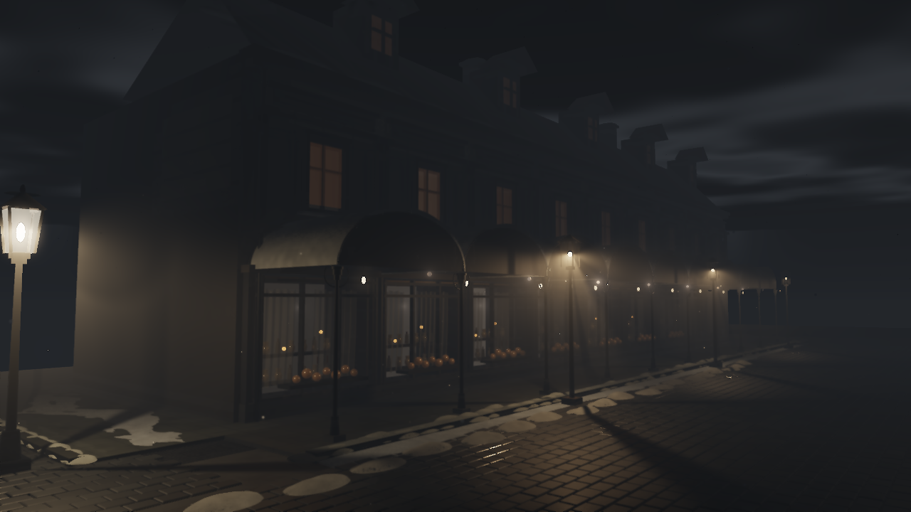
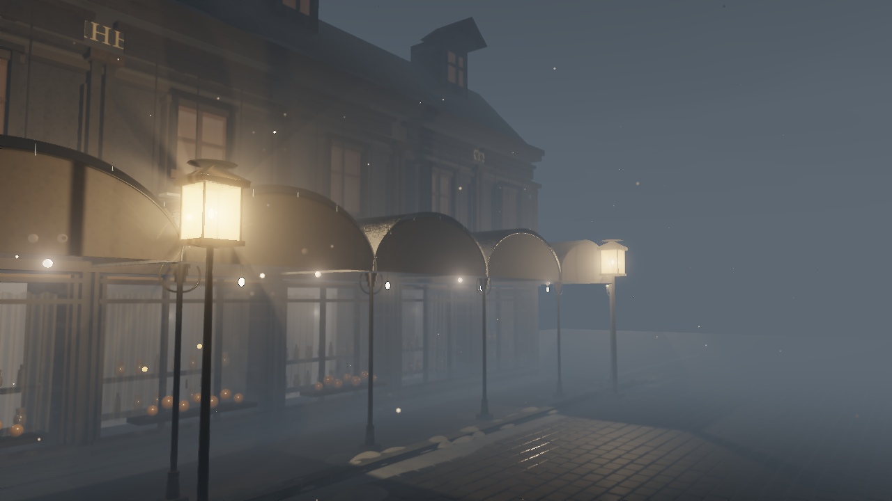
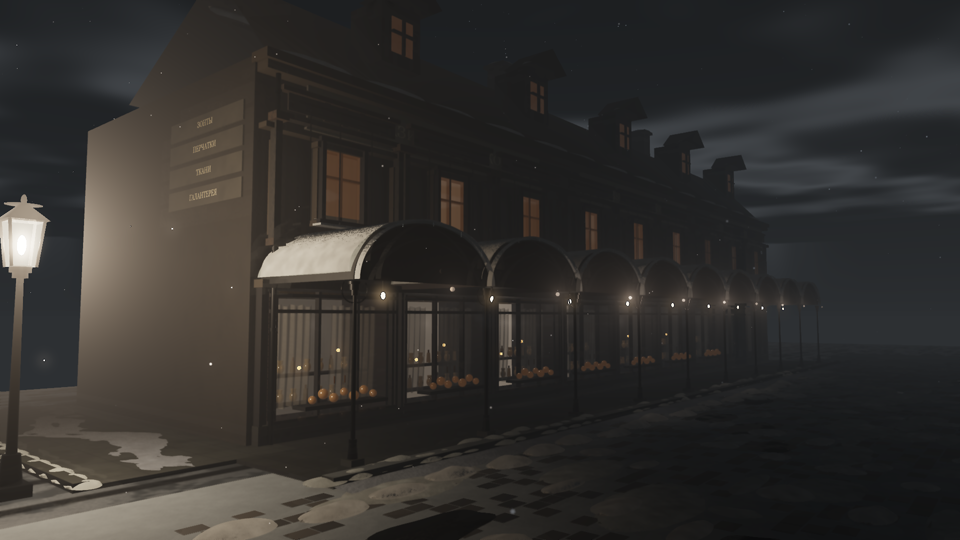
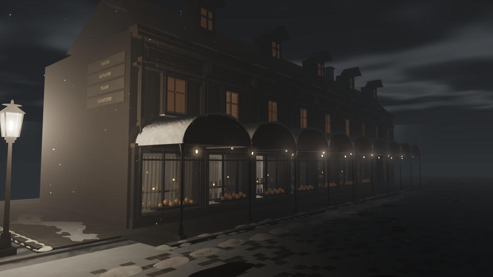

# Snowy arcade

`reference.scene.mjs` contains the scene used by the Meshwork worker. The default capture resolution is Full HD, 1920 × 1080, with 24 temporal warmup frames.

```sh
bun install --frozen-lockfile
bun run check
node tools/arcade/capture.mjs
```

Chrome with a hardware WebGPU adapter and ffmpeg must be available. On Windows, set `CHROME_PATH` to Chrome's executable. Set `ARCADE_WIDTH=3840` for a native 4K capture; the scene and simulation are the same.

Each canopy now has one continuous snow shell. Accumulation thins toward steep sides, with a seeded irregular front lip and geometric surface normals. The ground snowpack supplies the street's fine relief; repeated decorative ground clumps and overlapping canopy coatings are removed.

Snowfall uses integer particle seeds and absolute simulation time. It writes alpha-weighted particle velocity into the existing TAA motion target, accounts for camera motion, and avoids a long velocity trail when a particle wraps around the volume. Scene lights and distance fog control its brightness. Independent render workers use `setTimelineFrame(frame)` for matching TAA jitter and `resetTemporalHistory()` before warming a new range.

The live scene follows a closed 90-second camera rail. Position and look-at target are evaluated from simulation time, so different workers agree at segment boundaries. Calling `setCamera` selects a fixed inspection view; a scene reset restores the rail.

Two roads use seeded, bevelled granite setts with actual relief, wet material response and snow in the joints. Five rectangular glass lanterns illuminate the road. Each has four emissive transparent panes, an internal bulb, a square opaque cap and bottom, and metal corner ribs. Rays intersect the glass enclosure: the cap and bottom block vertical light, while the four sides transmit it. The same enclosure profile affects surface lighting, flakes and fog. Single scattering uses a [Henyey–Greenstein phase function](https://pbr-book.org/4ed/Volume_Scattering/Phase_Functions), finite-emitter equiangular samples and attenuation along both light paths. This is a bounded approximation with no volumetric shadows from surrounding buildings. The reflection probe refreshes one face per frame to limit worker load.

The house follows the supplied historical facade reference: larger side arches, a closed deep mansard with side dormers and chimneys, dark upper windows, standing roof seams, aged plaster and painted dark Cyrillic signs. The sign band no longer has raised panels hiding the lettering. Shop windows have backlit floral lace; the renderer preserves the curtain texture in the emissive response. `prepareArcadeTextures()` regenerates the local procedural assets. The original camera rail, warm lanterns and cobbled street remain.

The visible fog has independent in-scattered radiance `[0.095, 0.112, 0.13]`, ground extinction of 0.20/m, and exponential height falloff of 0.42/m. The first 2 m are clear; extinction increases linearly over the next 16 m. At camera height 2.55 m, horizontal visibility is about 93% at 8 m, 58% at 18 m, 25% at 30 m, and 7.4% at 48 m. The distant street stays hazy while the facade and dark cloud layers remain legible. Night clouds attenuate the sky's fog radiance instead of disappearing behind a uniform bright veil. Surfaces, flakes and lantern scattering share the distance profile. Moon illumination is 0.18; the reflection probe updates one face per frame. Fog appearance controls update uniforms without invalidating geometry. [720p travel evidence](../../docs/render-evidence/snowy-arcade-travel.json) contains four hardware captures and two-worker audiovisual playback with a live scene revision. These previews are native 1280 × 720 lossless WebP:

| Start of the route | Far end of the route |
| --- | --- |
|  |  |

`carriage-audio.mjs` exports deterministic interleaved stereo PCM through `renderAudio({startTime,duration,sampleRate:48000})`. One acoustic horse pulls a carriage with four independent wheel contacts. Two 15-second passes begin at 12 and 58 seconds of the 90-second loop, alternating direction behind the moving listener. Hoofbeats, wooden creaks and wheel impacts on cobbles fade with distance and pan across stereo; quiet winter air remains between passes. These are acoustic actors, with no visible geometry, shadows or reflections. PCM rendered in separate ranges matches the continuous waveform exactly.

Register in Meshwork with `--entry tools/arcade/reference.scene.mjs --audio tools/arcade/carriage-audio.mjs`. The broker encodes the shared 48 kHz AAC track and muxes the original video packets; render workers have audio disabled. The player has an explicit sound button for playback after a user gesture. Meshwork's scene director applies validated, absolute-frame controls within the existing HLS epoch. See the Meshwork README for chat setup and supported scene changes.

The [paired native FHD capture report](../../docs/render-evidence/snowy-arcade-fhd.json) records the same camera and time before/after. Its previews are downsampled to 960 × 540 and encoded as lossless WebP. This is desktop GPU evidence, not an iPad throughput benchmark or a claim of matching a photographic reference.

| Before | After |
| --- | --- |
|  |  |
